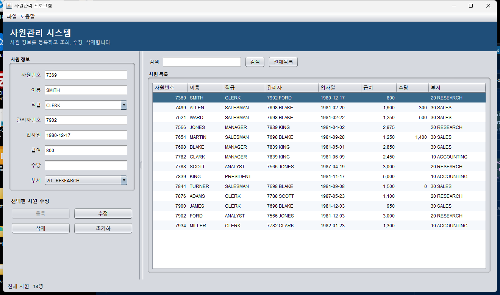
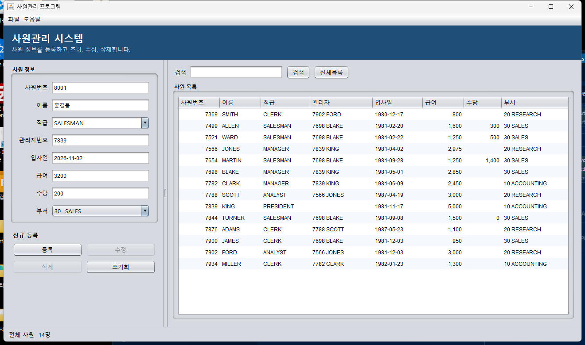
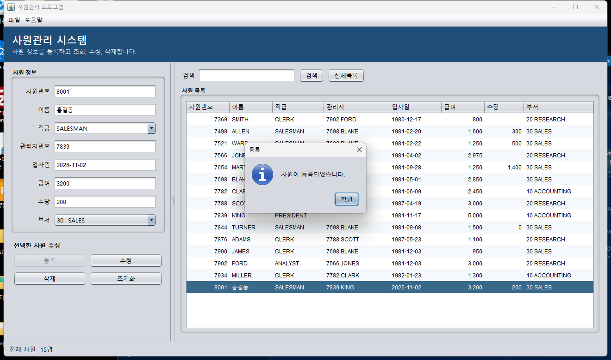
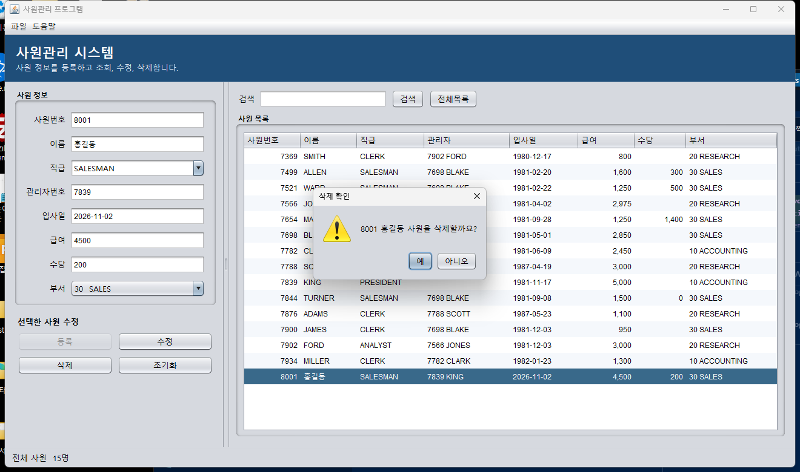

# 화면과 흐름

창 제목은 「사원관리 프로그램」이다. 위에는 제목 막대, 왼쪽에는 사원 정보, 오른쪽에는 검색과 사원 목록, 아래에는 인원 수가 있다.

## 영역

| 영역 | 구성 |
| --- | --- |
| 메뉴 | 파일(전체 새로고침, 종료), 도움말(프로그램 정보) |
| 사원 정보 | 사원번호, 이름, 직급, 관리자번호, 입사일, 급여, 수당, 부서 |
| 모드 | 「신규 등록」 또는 「선택한 사원 수정」 |
| 버튼 | 등록, 수정, 삭제, 초기화 |
| 검색 | 검색어, 검색, 전체목록 |
| 목록 | 사원번호, 이름, 직급, 관리자, 입사일, 급여, 수당, 부서 |
| 상태 줄 | 「전체 사원 N명」 또는 「검색 결과 N명」 |

목록의 칸은 직접 고칠 수 없다. 열 제목을 누르면 정렬된다. 급여와 수당은 천 단위 쉼표로 보인다.

## 모드

프로그램을 열면 신규 등록 모드다. 사원번호는 다음 번호로 채워지고, 등록 버튼만 사용할 수 있다.

목록에서 한 줄을 누르면 선택한 사원 수정 모드가 된다. 사원번호는 고칠 수 없고, 수정과 삭제 버튼을 사용할 수 있다. 초기화를 누르면 다시 신규 등록 모드로 돌아간다.

## 장면

### 조회

목록에서 SMITH를 선택한 상태다. 왼쪽에는 사원번호 7369, 이름 SMITH, 직급 CLERK, 관리자 7902, 입사일 1980-12-17, 급여 800, 부서 20 RESEARCH가 채워져 있다. 아래 상태는 전체 사원 14명이다.



### 등록 입력

초기화 뒤 새 사원을 입력한 상태다. 예시는 사원번호 8001, 이름 홍길동, 직급 SALESMAN, 관리자 7839, 입사일 2026-11-02, 급여 3200, 수당 200, 부서 30 SALES이다. 모드는 신규 등록이다.



### 등록 완료

등록이 끝나면 「사원이 등록되었습니다.」가 뜨고, 목록 아래에 8001 홍길동이 선택된 채로 나타난다. 상태는 전체 사원 15명으로 바뀐다.



### 수정

선택한 사원의 급여를 4500으로 바꾼 뒤 수정한 결과다. 「사원 정보가 수정되었습니다.」가 뜨고, 목록의 급여도 4,500으로 바뀐다.


### 삭제

삭제를 누르면 「8001 홍길동 사원을 삭제할까요?」를 묻는다. 예를 누르면 삭제되고, 아니오를 누르면 그대로 둔다.



## 흐름

```text
실행
  → 테이블이 없으면 샘플 데이터 생성
  → 전체 목록 표시, 신규 등록 모드

목록에서 사원 선택
  → 입력란에 값 표시, 수정 모드

초기화
  → 입력란을 비우고 다음 사원번호 제안, 신규 등록 모드

검색
  → 검색어가 있으면 결과 목록, 비어 있으면 전체 목록

등록 / 수정 / 삭제
  → 확인 또는 오류 메시지
  → 목록을 다시 읽어 선택 상태를 맞춘다
```
