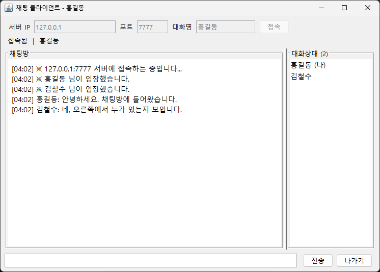

# 아카이브 카드

대상 페이지는 `portfolio_achieve/index.html`입니다. 번호는 PROJ_17 다음인 PROJ_18입니다. 그 사이에 다른 카드를 먼저 넣었다면 번호와 이미지 파일 이름을 함께 바꿉니다.

대표 이미지는 `img/proj-18-client-chat.png`입니다. 대화 내용, 말한 사람, 오른쪽 대화상대가 한 화면에 있습니다.

## 히어로에 덧붙일 문장

범위:

```text
PROJ_01부터 PROJ_09, 기관 과정 PROJ_10부터 PROJ_15, 바이브 코딩 PROJ_16부터 PROJ_18
```

현재 목록의 끝에 쉼표로 이어 붙입니다.

```text
PROJ_18 자바 채팅 · 2026년 11월 2일
```

목록 안내에는 다음 문장을 덧붙입니다.

```text
PROJ_18은 2026년 11월 2일에 로컬에서 서버와 클라이언트 둘을 실행해 입장·대화·접속자 목록을 확인했습니다.
```

## 카드 문장

- 제목: 자바 채팅
- 기간 표기: 2026.11.02
- 프로젝트 소개: 에듀펜 자바 네트워크 수업에서 만들었던 채팅을, 기억에 남은 구성대로 다시 구현한 프로그램입니다. 서버와 클라이언트를 Swing으로 나누고, 소켓과 버퍼 스트림으로 여러 사람이 한 방에서 대화합니다.
- 간단 설명: 서버는 7777번 포트에서 접속을 받습니다. 클라이언트는 가운데에 대화를 보여주고 오른쪽에 대화상대를 보여 줍니다. 2026년 11월 2일 실행에서 홍길동과 김철수가 입장한 뒤 서로 메시지를 주고받았고, 서버 로그와 접속자 목록에 같은 내용이 남았습니다.
- 사용 도구: Java, Socket, ServerSocket, InputStream, OutputStream, BufferedReader, BufferedWriter, Swing, Eclipse
- 실행 환경: JDK의 `java`로 로컬 실행. 이클립스에서 `ChatServer`, `ChatClient`를 실행하거나 `run-server.bat`, `run-client.bat`을 사용합니다. 같은 PC는 `127.0.0.1`, 다른 PC는 서버 로그에 표시된 IPv4와 포트 7777. 공개 호스팅 주소는 없습니다. 카드 캡처는 이 문서 폴더의 `img/`(2026년 11월 2일)입니다.
- 핵심 기능: 서버 실행·종료, 다중 접속, 입장·퇴장 안내, 이름 표시 대화, 오른쪽 대화상대, 나가기

## 붙일 HTML

`portfolio_achieve/index.html`에서 PROJ_17 `</article>` 다음, 추가 안내 주석 앞에 넣습니다. 이미지는 그 전에 `portfolio_achieve/img/`로 복사해 둡니다.

```html
<article class="project-card">
  <figure class="project-card__media">
    
  </figure>
  <div class="project-card__body">
    <p class="project-card__index">PROJ_18 · 2026.11.02</p>
    <h3 class="project-card__title">자바 채팅</h3>
    <div>
      <p class="field-label">프로젝트 소개</p>
      <p class="field-body">
        에듀펜 자바 네트워크 수업에서 만들었던 채팅을, 기억에 남은 구성대로 다시 구현한 프로그램입니다.
        서버와 클라이언트를 Swing으로 나누고, 소켓과 버퍼 스트림으로 여러 사람이 한 방에서 대화합니다.
      </p>
    </div>
    <div>
      <p class="field-label">간단 설명</p>
      <p class="field-body">
        서버는 7777번 포트에서 접속을 받습니다. 클라이언트는 가운데에 대화를 보여주고 오른쪽에 대화상대를
        보여 줍니다. 2026년 11월 2일 실행에서 홍길동과 김철수가 입장한 뒤 서로 메시지를 주고받았고,
        서버 로그와 접속자 목록에 같은 내용이 남았습니다.
      </p>
    </div>
    <div>
      <p class="field-label">사용 도구</p>
      <ul class="pill-list">
        <li>Java</li>
        <li>Socket</li>
        <li>ServerSocket</li>
        <li>Swing</li>
        <li>Eclipse</li>
      </ul>
    </div>
    <div>
      <p class="field-label">실행 환경</p>
      <p class="field-body">
        JDK의 <span class="path">java</span>로 로컬 실행. 이클립스에서
        <span class="path">ChatServer</span>, <span class="path">ChatClient</span>를 실행하거나
        <span class="path">run-server.bat</span>, <span class="path">run-client.bat</span>을 사용합니다.
        같은 PC는 127.0.0.1, 다른 PC는 서버 로그의 IPv4와 포트 7777. 공개 호스팅 주소는 없습니다.
        카드 캡처는 채팅 프로젝트의 <span class="path">DOC_JAVA_CHATPROGRAM_PROJ/img/</span>입니다.
        2026년 11월 2일 확인.
      </p>
    </div>
    <div>
      <p class="field-label">핵심 기능</p>
      <p class="field-body">
        서버 실행·종료, 다중 접속, 입장·퇴장 안내, 이름 표시 대화, 오른쪽 대화상대, 나가기
      </p>
    </div>
  </div>
</article>
```
