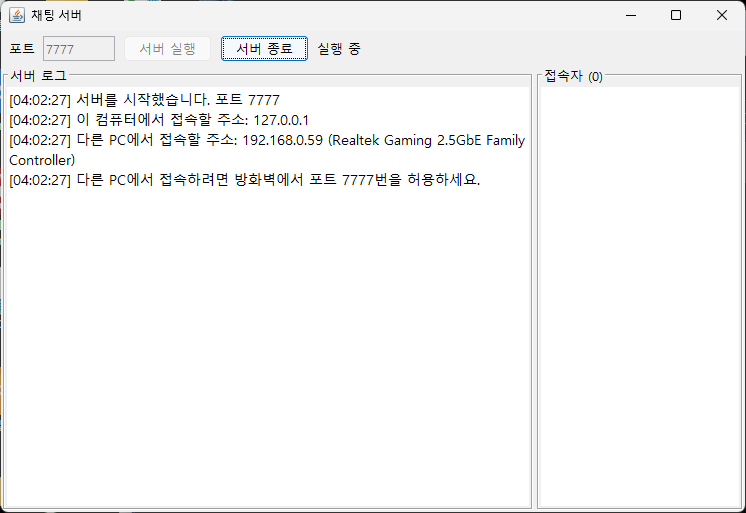
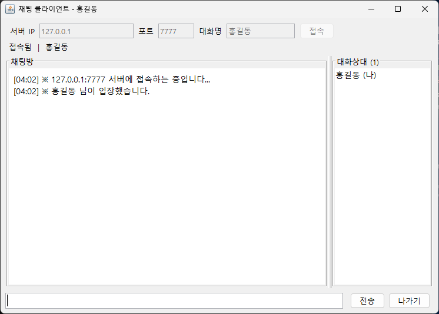
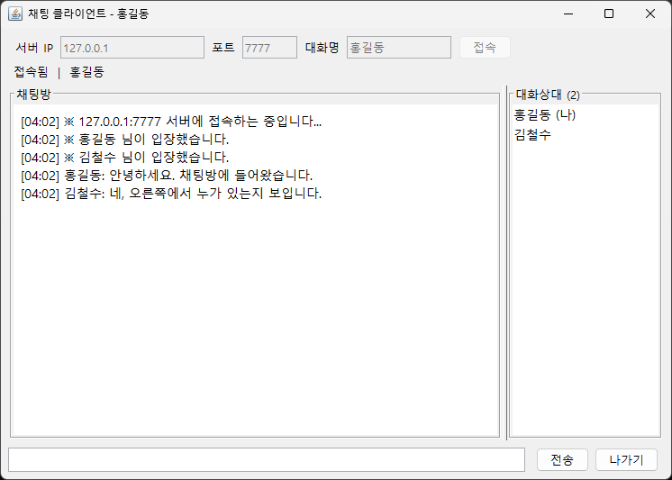
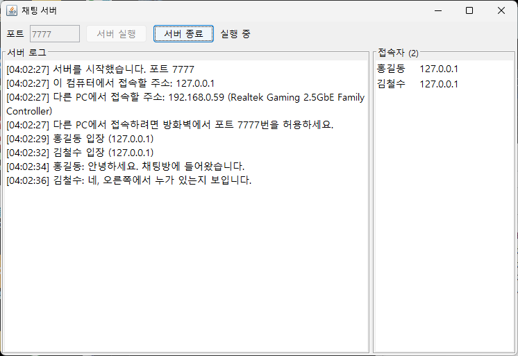

# 개요

## 한 줄 설명

여러 클라이언트가 한 자바 서버에 접속해 텍스트로 대화하는 Swing 채팅 프로그램입니다.

## 다시 만든 이유

에듀펜 자바 네트워크 수업을 들으며 이클립스에서 만든 채팅이 있었습니다. 오래되어 소스의 줄 단위는 기억나지 않고, 당시 구성만 남아 있습니다.

- IDE는 이클립스
- `Socket`으로 서버와 클라이언트를 연결
- `InputStream`, `OutputStream`을 버퍼 스트림으로 감싸 읽고 씀
- 화면은 Swing
- 서버 하나와 클라이언트 여러 개
- 다른 PC에서도 접속
- 채팅방 가운데에 대화, 오른쪽에 대화상대
- 누가 들어오고 누가 말하는지 구분
- 서버 실행, 클라이언트 실행, 대화, 나가기

아카이브의 PROJ_15 에듀펜 항목은 2017년부터 2019년 과정이고, 2026년 10월 18일에 폴더를 열었을 때 파일이 없었습니다. 이 프로젝트는 그 유실된 파일을 복구한 것이 아닙니다. 2026년 11월 2일에 위 구성으로 새로 구현하고, 같은 날 로컬에서 실행해 확인한 기록입니다.

로컬 폴더 이름은 `java_chatprogram)proj`이고, 이클립스 프로젝트 이름은 `JavaChat`입니다.

## 확인한 실행

2026년 11월 2일, JDK 26으로 서버를 7777번에 연 뒤 클라이언트 둘을 접속했습니다.

| 순서 | 확인 내용 |
| --- | --- |
| 서버 시작 | 포트 7777, 상태 `실행 중`, 접속자 0명 |
| 홍길동 입장 | 채팅방에 입장 안내, 대화상대에 `홍길동 (나)` |
| 김철수 입장 | 홍길동 화면에 입장 안내, 대화상대 2명 |
| 대화 | 홍길동 `안녕하세요. 채팅방에 들어왔습니다.` / 김철수 `네, 오른쪽에서 누가 있는지 보입니다.` |
| 서버 | 접속자 목록에 두 이름과 `127.0.0.1`, 로그에 같은 대화 |

화면은 `img/`에 있습니다.

### 서버 실행

### 클라이언트 입장

### 대화

### 서버에서 본 방

## 범위

이 문서가 다루는 기능은 서버 실행과 종료, 접속, 대화, 나가기, 입장·퇴장 안내, 대화상대 목록입니다. 귓속말, 파일 전송, 로그인 계정, 데이터베이스는 없습니다.

외부 라이브러리는 쓰지 않습니다. JDK의 네트워크 API와 Swing만 사용합니다.
