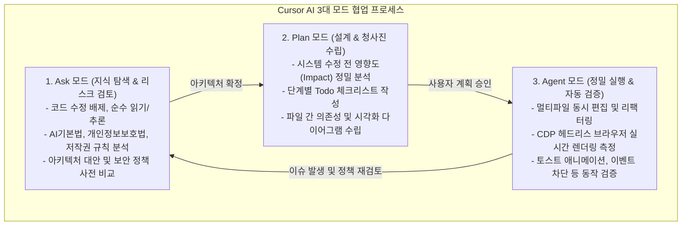
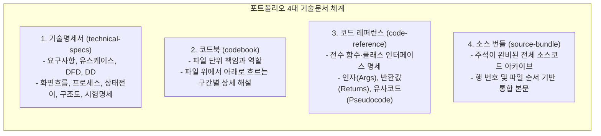
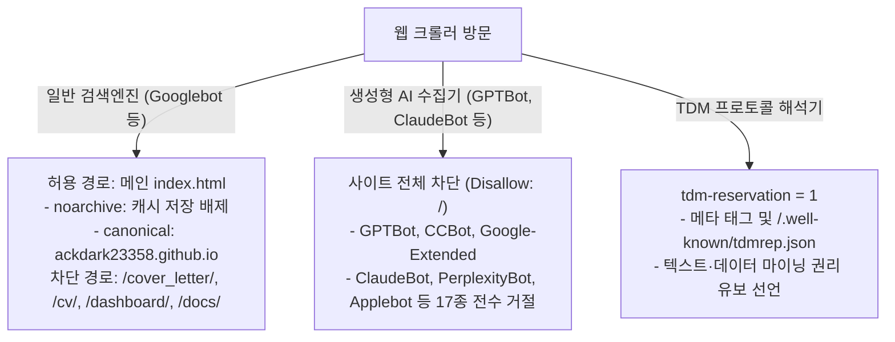

# 코탐록 포트폴리오 북 (Kotamrok Portfolio Book)

### 웹·모바일·AI 서비스를 잇는 코딩 탐험가의 여정과 엔지니어링 아카이브

---

- **작성자**: 김신욱 (GitHub: [ackdark23358](https://github.com/ackdark23358))
- **공개 호스팅 주소**: [https://ackdark23358.github.io/](https://ackdark23358.github.io/)
- **개발 환경 및 도구**: Cursor AI (바이브 코딩 에코시스템), Vanilla HTML5/CSS3/JavaScript, Python
- **발행일**: 2026년 5월 25일
- **최종 개정일**: 2026년 10월 17일
- **저작권 표기**: © 2026 김신욱(깃허브 ackdark23358). All rights reserved.

---

> **[문장 생성 및 출처 선언]**  
> 본 포트폴리오 북 및 웹 사이트 전반에서 자료(독서·강의·과제 등의 학습 원문 및 데이터)를 제외한 문장이나 문구는 지원자의 생각을 Cursor AI 프롬프트에 명확히 요청하여 생성하고 다듬은 문장이나 문구입니다.  
> 인공지능 도구(Cursor AI)는 지원자의 생각과 의도를 구현하는 지능형 파트너로 기능하였으며, 소프트웨어 아키텍처 수립, 법률·정책적 리스크 검토, 기술문서 체계 설계, 코드 품질 관리 및 최종 책임은 온전히 사람(지원자)에게 있습니다.

---

## 목차 (Table of Contents)

- **제1장. 프로젝트 소개 및 서비스 구성**
  - 기획 의도 및 핵심 가치
  - 6대 정적 웹 서비스 상세 안내 (메인 자기소개서, 프로필, 3D 온라인 명함, 이력서, 학습록 대시보드, 프로젝트 아카이브)
  - 무의존성 정적 웹 구조와 전체 사이트맵 체계
- **제2장. Cursor AI 바이브 코딩 방법론**
  - 바이브 코딩(Vibe Coding)의 본질과 패러다임 전환
  - Ask 모드: 법률·규제·라이선스 검토 및 사전 의사결정
  - Plan 모드: 영향도 분석과 단계별 실행 청사진 수립
  - Agent 모드: 정밀 멀티파일 편집과 브라우저(CDP) 실시간 검증
  - 프롬프트 엔지니어링과 인간 주도의 품질 책임 원칙
- **제3장. 체계적인 기본 기술문서 체계**
  - 엔지니어링 표준을 수립한 4대 기술문서 생태계
  - 기술명세서 (`technical-specs`): 요구사항부터 시험 명세까지
  - 코드북 (`codebook`): 파일 단위의 책임과 구간별 코드 해설
  - 코드 레퍼런스 (`code-reference`): 심층 함수·클래스 명세 및 유사코드
  - 소스 번들 (`source-bundle`): 주석 기반의 통합 원본 소스 아카이브
  - Markdown과 Mermaid 다이어그램 기반 자동화 빌드 파이프라인
- **제4장. 웹 아키텍처 및 주요 기능 구현**
  - 프레임워크 없는 순수 Vanilla Web 아키텍처의 강점
  - 3D 스크롤 인터랙션과 명함 회전·확대 애니메이션
  - 55종 학습 데이터의 지연 로딩(Lazy Loading) 및 클라이언트 실시간 검색
  - 시맨틱 마크업, 접근성(`aria-*`, 스킵 링크) 및 테마 동기화 메커니즘
- **제5장. 정적 배포 환경의 보안·거버넌스 및 SEO 전략**
  - GitHub Pages 환경의 보안적 한계 인식
  - 클라이언트 사이드 리소스 보호 레이어 (`protect-resources.js`)
  - 인가 호스트 화이트리스트 검증 및 악의적 임베딩(iframe) 차단
  - 무단 복사·스크랩 방지 토스트 알림 및 학점은행제 개인정보 마스킹
  - 검색엔진 최적화(SEO)와 인공지능 무단 크롤링 방지(GEO/TDM)의 공존 전략
- **제6장. 55개 학습 아카이브와 미래 비전**
  - 37권의 독서·강의 노트와 18건의 멀티미디어학 학점은행제 과제
  - Visual Basic, 통계 도구부터 Java, Kotlin, Modern Web, Cursor AI로 이어진 성장 궤적
  - 실무에 바로 투입 가능한 준비된 IT 주니어 개발자의 다짐과 비전

# 제1장. 프로젝트 소개 및 서비스 구성

## 1.1 기획 의도 및 핵심 목표

오늘날 IT 소프트웨어 업계는 웹, 모바일, 그리고 급격히 발전하는 인공지능(AI) 서비스의 융합을 요구하고 있습니다. 본 포트폴리오 프로젝트 '코탐록(코딩 탐험가 기록소)'은 웹과 모바일, AI 기술을 지속해서 탐험하고 내재화해 온 지원자의 역량과 학습 궤적을 세상에 증명하기 위해 기획되었습니다.

단순한 텍스트 나열형 포트폴리오를 넘어, 실제 동작하는 웹 기술과 체계적인 엔지니어링 산출물을 유기적으로 결합하여 다음과 같은 핵심 가치를 전달하고자 했습니다:

- **실무 즉시 적응력 증명**: 웹 기초 표준(HTML5, CSS3, JavaScript)부터 반응형 레이아웃, 인터랙티브 3D 뷰포트 기법, 비동기 데이터 처리에 이르는 프런트엔드 역량을 실제 구현으로 증명합니다.
- **체계적인 엔지니어링 문서화**: 개발 전반에 걸쳐 요구사항 명세, 자료 흐름도(DFD), 코드북, 상세 API 명세를 작성하여 협업과 유지보수에 강한 개발자의 기본기를 보여줍니다.
- **AI 도구와의 창의적 협업(Vibe Coding)**: 최신 AI IDE인 Cursor의 세 가지 작업 모드(Ask, Plan, Agent)를 목적에 맞게 구동하여 개발 생산성을 극대화하고 품질을 검증했습니다.
- **보안 및 법률적 거버넌스 준수**: 정적 호스팅 환경(GitHub Pages)의 특성을 고려한 보안 레이어, 개인정보 보호 마스킹, AI 무단 크롤링 방지(TDM/GEO)를 선제적으로 설계했습니다.

---

## 1.2 6대 정적 웹 서비스 구성

본 프로젝트는 단일 페이지 애플리케이션의 복잡한 런타임 의존성을 배제하고, 목적별로 명확히 분리된 6개의 독립 정적 웹 서비스로 구성되어 있습니다. 각 페이지는 상호 연결된 공통 내비게이션과 하단 사이트맵을 통해 자유롭게 탐색할 수 있습니다.

| 번호 | 서비스 명칭 | 파일 경로 | 주요 역할 및 특징 |
| :---: | :--- | :--- | :--- |
| **1** | **메인 자기소개서** | `index.html` | 지원 동기, 성장 과정, 보유 역량, 강점 및 보완점, 참고 정보를 담은 메인 랜딩 포털 |
| **2** | **자기소개 / 프로필** | `cover_letter/profile.html` | 상세 프로필, 관심 분야, 학습 경험, 생활신조를 담은 심층 자기소개 문서 |
| **3** | **온라인 명함** | `online_business_card/business-card.html` | 마우스 스크롤 위치에 따라 3D 카드가 회전·확대되는 인터랙티브 쇼케이스 |
| **4** | **문서형 이력서** | `cv/resume.html` | 경력, 학력, 자격 사항을 깔끔하고 정제된 표준 문서 형식으로 제공하는 이력서 |
| **5** | **학습·과제 아카이브** | `study_note_record_organization/dashboard/index.html` | 55건의 독서·강의·과제 기록을 실시간 검색하고 원본 텍스트를 열람하는 대시보드 |
| **6** | **프로젝트 아카이브** | `portfolio_achieve/index.html` | 만든 프로젝트(PROJ_01~PROJ_09)를 카드로 정리하고 사용 도구·환경·기능을 확인하는 아카이브 |

### 1) 메인 자기소개서 (`index.html`)
포트폴리오의 허브 역할을 수행하는 첫 관문입니다. 반응형 카드 그리드, 다크 모드 토글, 상단 스킵 내비게이션, 그리고 지원 분야별 핵심 역량과 포부를 명확한 타이포그래피로 전달합니다. 하단에는 전 페이지를 아우르는 전개형 사이트맵과 저작권, AI 생성 선언문이 배치되어 있습니다.

### 2) 자기소개 / 프로필 (`cover_letter/profile.html`)
지원자의 개발 철학과 인간적 가치관을 조망하는 상세 페이지입니다. 인용문과 정갈한 본문 구조를 통해 컴퓨터 기초 및 멀티미디어학 전공부터 데이터 분석, 모바일 앱, 생성형 AI로 이어지는 깊이 있는 탐구 여정을 기술합니다.

### 3) 3D 스크롤 인터랙티브 온라인 명함 (`online_business_card/business-card.html`)
코딩 탐험가 콘셉트의 시각적 하이라이트입니다. CSS 3D 트랜스폼(`transform: rotateY, scale`)과 스크롤 진행률 이벤트를 정밀하게 결합하여, 사용자가 스크롤을 내릴 때 명함이 회전하고 전면으로 확대되며, 이후 다크 톤의 요약 이력서 영역으로 자연스럽게 이어집니다.

### 4) 문서형 이력서 (`cv/resume.html`)
실제 채용 담당자가 편안하게 정보를 검토할 수 있도록 여백과 타이포그래피에 집중한 정통 문서형 이력서입니다. 주요 경력과 학력, 보유 자격증 목록을 깔끔한 타임라인 형식으로 배치하였으며, 인쇄 및 열람 시 최적의 가독성을 보장합니다.

### 5) 학습·과제 기록 아카이브 (`study_note_record_organization/dashboard/index.html`)
지원자가 수년간 쌓아온 독서 노트 37권과 학점은행제 과제 수행 기록 18건을 시각화한 데이터 대시보드입니다. 상단에 포토 갤러리 히어로 섹션을 배치하고, 하단에는 실시간 클라이언트 검색창과 카드 그리드를 제공합니다. 요약 팝업과 지연 로딩 기반의 원본 뷰어를 통해 학습의 깊이를 입증합니다.

### 6) 프로젝트 아카이브 (`portfolio_achieve/index.html`)
파이썬 기초 실습부터 댓글 게시판, 웹 스토리지 할 일 목록, 카카오맵 공공데이터 시각화, 생성형 AI(ChatGPT, Copilot, Cursor) 미니 프로젝트에 이르는 총 9개 프로젝트(`PROJ_01` ~ `PROJ_09`)를 카드로 모듈화한 아카이브입니다. 각 카드마다 사용 도구(Pill 태그), 실행 환경, 간단 설명, 핵심 기능을 정형화하여 표시하며, 상세 화면(`proj-01.html` ~ `proj-09.html`)으로 원활히 연결됩니다.

---

## 1.3 전체 시스템 아키텍처 및 무의존성 설계

본 프로젝트는 npm, webpack, vite 같은 무거운 빌드 툴이나 프레임워크 런타임에 의존하지 않는 **'무의존성 순수 정적 웹(Vanilla Static Web)'** 아키텍처를 고수합니다.

- **극대화된 안정성과 호환성**: 모든 웹 브라우저(Chrome, Edge, Safari, Firefox 등) 및 모바일 환경에서 별도의 트랜스파일링 없이 즉시 실행됩니다.
- **GitHub Pages 최적화**: 정적 파일 그대로 저장소에 푸시하면 GitHub Pages를 통해 지연 시간 없이 전 세계에 서비스됩니다.
- **유지보수 용이성**: 디렉터리별로 HTML, CSS, JavaScript 파일이 명확히 모듈화되어 있어 개별 페이지의 스타일이나 동작을 독립적으로 수정 및 확장할 수 있습니다.
- **영구 보존성**: 프레임워크 버전 업그레이드로 인한 호환성 깨짐(Breaking Changes) 위험이 전혀 없어 수십 년 후에도 동일한 렌더링을 보장합니다.

# 제2장. Cursor AI 바이브 코딩 방법론

## 2.1 바이브 코딩(Vibe Coding)의 본질과 패러다임 전환

'바이브 코딩(Vibe Coding)'은 인공지능이 코드를 대필하는 단순 자동완성을 의미하지 않습니다. 바이브 코딩의 본질은 **"사람의 명확한 의도와 아키텍처 설계를 고도화된 자연어 프롬프트로 전달하고, AI 엔진의 연산력과 속도를 활용하여 빠르고 정밀하게 소프트웨어를 조립하며, 그 결과에 대해 인간이 엄격한 품질과 책임을 담보하는 개발 패러다임"**입니다.

본 프로젝트는 기획 단계부터 전체 아키텍처 수립, 코드 작성, 브라우저 실시간 검증, 그리고 기술문서 생태계 구축에 이르는 전 과정을 Cursor AI 환경에서 체계적인 바이브 코딩 방식으로 완수했습니다. 

단순히 "이 기능 만들어 줘" 식의 단발성 요청이 아니라, Cursor가 제공하는 3대 작업 모드(Ask, Plan, Agent)를 유기적으로 전환하며 전통적인 소프트웨어 공학의 엄격함을 AI 기반 개발에 성공적으로 접목했습니다.

---

## 2.2 Cursor AI 3대 모드의 유기적 운용 라이프사이클

Cursor AI 환경의 핵심은 코드 수정 권한과 컨텍스트의 성격에 따라 분리된 3대 모드입니다. 본 프로젝트는 각 모드의 특성을 철저히 지키며 개발을 진행했습니다.

### 1) Ask 모드: 법률·정책적 검토 및 사전 의사결정
- **역할 및 특징**: 프로젝트 코드를 직접 변경하지 않고, 전체 코드베이스와 외부 지식을 탐색하며 질문과 답변, 설계 대안을 심층 토론하는 모드입니다.
- **실제 프로젝트 적용 사례**:
  - **인공지능기본법(2026년 1월 시행)** 및 디지털 관련 법령에 대한 호스팅 영향도 분석
  - 정적 웹사이트에서 third-party 교재·강의 요약의 저작권 공정이용 범위 및 포트폴리오 표기 원칙 논의
  - 공개 GitHub Pages 환경에서 학점은행제 과제 원본에 포함된 타인 개인정보(교수명, 타 학생 학번)의 노출 리스크 식별
  - robots.txt와 TDM(Text and Data Mining) 협약 적용 가능 여부 사전 타당성 검토

### 2) Plan 모드: 영향도 분석과 단계별 실행 청사진 수립
- **역할 및 특징**: 맹목적인 코드 수정을 방지하기 위해 파일 간 종속성을 분석하고, 전체 작업의 순서도와 체크리스트(Todo), 파일 경로 단위의 구체적 변경 계획서를 작성하는 모드입니다.
- **실제 프로젝트 적용 사례**:
  - 하단 전체 사이트맵 전개 및 저작권자 변경 시 5개 독립 HTML과 각각의 CSS에 미치는 영향 분석
  - 정적 사이트 보안 가드(`protect-resources.js`) 추가 시 학습록 대시보드(`app.js`)의 비동기 데이터 fetch와의 로딩 순서 간섭 분석
  - 지금 읽고 계신 '포트폴리오 북 PDF 제작 계획'을 포함하여, 모든 복합 작업에 대해 사전에 구조화된 계획서(`.plan.md`)를 작성하고 승인 후 실행

### 3) Agent 모드: 정밀 멀티파일 편집과 브라우저(CDP) 실시간 검증
- **역할 및 특징**: 파일 시스템 제어, 정규식 치환, 터미널 명령 실행 및 헤드리스 브라우저(Chrome DevTools Protocol)를 통합하여 실제 코드를 수정하고 렌더링 결과를 시각적으로 검증하는 자율 실행 모드입니다.
- **실제 프로젝트 적용 사례**:
  - 5개 HTML 및 4개 CSS 파일 전반의 하단 푸터 및 사이트맵 구조를 병렬 도구 호출로 정확하게 동기화
  - Cursor 내장 브라우저 환경에서 실제 웹페이지를 띄우고(CDP `Runtime.evaluate`), `copy` 이벤트 발생 시 안내 토스트 팝업의 CSS 애니메이션 동작 여부 확인
  - 3D 명함 페이지의 스크롤 위치 이동 및 반응형 모바일 뷰포트에서의 레이아웃 깨짐(Overflow) 실시간 자동 스크린샷 측정

---

## 2.3 프롬프트 엔지니어링과 인간 주도의 품질 책임 원칙

바이브 코딩을 성공으로 이끄는 가장 중요한 요소는 **'지시의 명확성'**과 **'인간의 최종 검수'**입니다.

### 1) 명확한 맥락과 제약 조건의 전달
지원자는 Cursor AI에 명령을 내릴 때 항상 다음과 같은 원칙을 견지했습니다:
- **배경 맥락 제공**: "정적 GitHub Pages 배포 환경이므로 서버 측 세션이나 백엔드 라우터가 없음"
- **명시적 부정 제약(Negative Constraints)**: "학습록 검색창의 키보드 입력은 절대 막지 말 것", "본문 읽기를 방해하는 스크롤 잠금은 절대 하지 말 것"
- **구체적인 산출물 형태 지정**: "반응형 2단 컬럼이 유지되는 펼친 사이트맵", "애니메이션 알림 토스트"

### 2) 문장 생성 원칙과 윤리적 선언
본 프로젝트는 투명한 AI 활용을 위해 전 페이지와 문서에 다음 원칙을 일관되게 명시했습니다:

> **"자료를 제외한 문장이나 문구는 나의 생각을 프롬프트에 요청하여 생성한 문장이나 문구입니다."**

- **생각의 주체는 사람**: 지원자가 어떤 방향으로 커리어를 쌓았고, 어떤 가치관을 지니고 있으며, 어떤 구조로 포트폴리오를 구성할지에 대한 설계와 논리는 100% 사람의 머리에서 나왔습니다.
- **생성의 주체는 AI 프롬프트**: 그 생각을 정제된 문장과 표현으로 다듬는 과정을 Cursor AI 프롬프트를 통해 수행했습니다.
- **자료와의 명확한 분리**: 독서 노트나 학점은행제 과제 등 지원자가 직접 공부하고 정리한 학습 원문(자료)은 AI 문장 생성의 대상에서 명확히 제외하여 진정성을 확보했습니다.

# 제3장. 체계적인 기본 기술문서 체계

## 3.1 소프트웨어 공학 표준을 준수한 4대 기술문서 생태계

일반적인 웹 포트폴리오는 화면 결과물만 보여주고 끝나는 경우가 대부분입니다. 하지만 실무 개발 현장에서 가장 중요한 역량은 **"자신이 작성한 소프트웨어가 어떤 요구사항에 의해 출발했고, 어떤 아키텍처로 설계되었으며, 향후 동료 개발자가 어떻게 유지보수할 수 있는가"**를 명확히 문서화하는 능력입니다.

본 프로젝트는 순수 정적 웹 사이트임에도 불구하고, 대규모 엔터프라이즈 시스템에 필적하는 엄격한 소프트웨어 공학 표준에 맞추어 **4대 기술문서(Technical Documentation Suite)**를 사전에 완벽히 구축해 두었습니다.

---

## 3.2 4대 기술문서별 상세 구성 및 역할

### 1) 기술명세서 (`docs/technical-specs.pdf`, `docs/technical-specs.md`)
소프트웨어 분석 및 설계의 교과서적인 산출물들을 집대성한 핵심 문서입니다.
- **요구사항 명세서 (Requirements)**: 기능 요구사항과 비기능 요구사항(성능, 접근성, 무의존성) 정의
- **유스케이스 다이어그램 및 명세서 (Use Cases)**: 방문자(Visitor)와 작성자(Author)의 액터 분리 및 상호작용 흐름
- **자료 흐름도 (DFD, Data Flow Diagram)**: Level 0 및 Level 1 DFD를 통해 원본 텍스트가 빌드 스크립트를 거쳐 대시보드 데이터로 가공되는 파이프라인 시각화
- **자료 사전 (DD, Data Dictionary)**: 카탈로그 JSON 구조, 청크 포맷, `localStorage` 키-값 정의
- **화면 흐름도 (Screen Flow)**: 5대 페이지 및 서브 섹션 간의 이동 경로 및 트랜지션
- **프로세스 명세서 (Process Specification)**: 검색 엔진 필터링 알고리즘, 개인정보 마스킹 로직의 구조화된 기술
- **상태 전이도 (State Transition)**: 다크/라이트 테마 변경 및 요약/원본 모달 팝업 상태 변화도
- **구조도 (Structure Chart)**: 모듈 간의 호출 관계와 데이터 전달 흐름
- **시험 명세서 (Test Specification)**: 화면 반응형 테스트, 키보드 접근성 테스트, 검색 결과 일치성 시험 케이스

### 2) 코드북 (`docs/codebook.pdf`, `docs/codebook.md`)
코드를 처음 접하는 개발자가 프로젝트를 한눈에 파악할 수 있도록 '파일 읽는 가이드' 역할을 수행합니다.
- **대상 범위**: 메인 포털, 이력서, 프로필, 3D 온라인 명함, 학습록 대시보드 및 빌드 파이프라인
- **해설 포맷**: 각 파일의 단일 책임(Single Responsibility) 정의 -> 추천 읽는 순서 -> 코드 구간별 논리 해설 -> 연계 파일 매핑

### 3) 코드 레퍼런스 (`docs/code-reference.pdf`, `docs/code-reference.md`)
모든 JavaScript 및 Python 함수/클래스를 망라한 표준 API 참조 문서입니다.
- **함수 시그니처**: 함수명, 인자 타입, 반환값 타입 명시
- **기능 요약**: 해당 함수가 해결하는 구체적인 문제 정의
- **유사코드(Pseudocode)**: 언어에 구애받지 않고 동작 알고리즘을 직관적으로 이해할 수 있는 슈도코드 수록

### 4) 소스 번들 (`docs/source-bundle.pdf`, `docs/source-bundle.html`)
프로젝트를 구성하는 모든 프로덕션 코드와 빌드 스크립트를 주석과 함께 하나의 거대한 문서로 병합한 아카이브입니다.
- 파일 순서대로 정렬되어 있으며, 각 줄마다 명확한 행 번호가 매겨져 있습니다.
- 학점은행제 과제의 민감 데이터나 방대한 원문 데이터는 제외하고, 오직 엔지니어링 산출물에 해당하는 핵심 소스만을 엄선하여 컴파일했습니다.

---

## 3.3 문서 자동화 빌드 파이프라인 (Build Pipeline)

본 프로젝트의 기술문서들은 사람이 일일이 워드 프로세서로 작성한 정적 파일이 아닙니다. 변경 사항이 발생하면 즉시 코드를 파싱하고 마크다운을 결합하여 PDF로 자동 렌더링하는 전용 파이썬 빌더들이 뒷받침하고 있습니다.

| 빌더 스크립트 | 생성 산출물 | 핵심 동작 방식 |
| :--- | :--- | :--- |
| `docs/build_specs.py` | `technical-specs.pdf` | 마크다운 내 Mermaid 코드를 파싱하여 Edge 헤드리스 브라우저로 렌더링하고 이미지 잘라내기 후 A4 PDF 출력 |
| `docs/build_codebook.py` | `codebook.pdf` | 챕터별 마크다운을 통합하고 인쇄용 CSS를 적용하여 고화질 한글 PDF 변환 |
| `docs/build_code_reference.py` | `code-reference.pdf` | 소스 내 독스트링(Docstring)과 주석을 정규식으로 파싱하여 API 레퍼런스 자동 생성 |
| `docs/build_source_bundle.py` | `source-bundle.pdf` | 전수 소스 파일에 주석을 보강하고 문법 하이라이팅 스타일을 입혀 단일 PDF로 묶음 |
| `docs/build_portfolio_book.py` | `portfolio-book.pdf` | 본 포트폴리오 북의 챕터들을 통합하여 표지, 목차, 인쇄 스타일이 완비된 단행본 PDF 생성 |

이러한 문서 자동화 파이프라인은 코드가 수정되었을 때 문서가 뒤처지는 '문서화의 지연(Documentation Drift)' 문제를 근본적으로 방지합니다.

# 제4장. 웹 아키텍처 및 주요 기능 구현

## 4.1 무의존성(Zero-Dependency) 웹 프런트엔드 구조

현대 프런트엔드 생태계는 번들러, 트랜스파일러, 방대한 npm 패키지에 과도하게 의존하는 경향이 있습니다. 이는 빠른 초기 개발에는 유리할 수 있으나, 패키지 보안 취약점, 빌드 깨짐, 런타임 오버헤드라는 부작용을 낳습니다.

본 포트폴리오는 웹 표준 기술(Web Standards) 본연의 힘을 입증하기 위해 외부 라이브러리를 일절 배제한 **순수 Vanilla Web 기술**로 전 기능을 구현했습니다:

- **네이티브 DOM 조작**: React나 Vue 없이도 직관적이고 결함 없는 이벤트 리스너와 DOM 트리 제어
- **표준 CSS 커스텀 속성(CSS Variables)**: 테마 색상, 타이포그래피 스케일, 간격(Spacing)을 중앙에서 관리하여 CSS 전처리기(Sass 등) 없이도 일관된 디자인 시스템 구축
- **최소 네트워크 페이로드**: 번들 크기가 극도로 작아 모바일 저속 네트워크에서도 즉각적인 로딩 속도 달성

---

## 4.2 주요 핵심 기능 구현

### 1) 3D 스크롤 인터랙션 및 카드 애니메이션 (`online_business_card`)
- **원리**: 250vh에 달하는 가상 스크롤 높이를 기반으로, 사용자의 스크롤 오프셋을 0.0 ~ 1.0의 진행률(Progress)로 변환합니다.
- **3D Transform**: CSS `perspective: 1000px`, `transform: rotateY(...) scale(...)` 속성을 결합하여, 스크롤을 내릴 때 명함 카드가 부드럽게 180도 회전하며 입체적으로 시야 앞으로 전진합니다.
- **성능 최적화**: `requestAnimationFrame`과 `will-change: transform`을 적용하여 화면 떨림이나 프레임 드롭(Jank) 없는 60fps 애니메이션을 구현했습니다.
- **자연스러운 전환**: 카드가 최대 크기로 도달하면 하단의 다크 톤 요약 이력서 영역이 서서히 드러나며 스크롤 탐색 흐름이 끊기지 않도록 설계되었습니다.

### 2) 55종 학습 데이터의 지연 로딩(Lazy Loading) 및 검색 대시보드 (`dashboard`)
- **청크(Chunk) 단위 분할**: 55개에 달하는 독서·과제 원본 텍스트는 수 메가바이트에 이를 수 있으므로, 초기 로딩 시에는 메타데이터와 요약문(`data.js`)만 가볍게 내려받습니다.
- **지연 로딩(Lazy Loading)**: 방문자가 특정 카드를 클릭하여 "원본 보기"를 요청하는 순간에만 해당 청크 파일(`sources/*.js`)을 비동기 스크립트 주입 방식으로 동적 로드합니다.
- **실시간 다중 필터링**: 사용자가 검색창에 키워드를 입력하면(`keyup`, `input`), 제목, 카테고리 태그, 핵심 요약문 전반을 정규식으로 즉시 매칭하여 0.01초 이내에 일치하는 카드들만 화면에 리렌더링합니다.

### 3) 테마 동기화 (Dark / Light Theme Sync)
- **CSS 변수 기반 테마**: `:root`와 `[data-theme="dark"]` 선택자를 활용해 텍스트, 배경, 테두리, 카드 색상을 즉시 전환합니다.
- **크로스 페이지 동기화**: `localStorage.getItem("portfolio-theme-v2")`를 통해 5개 서브 페이지 중 어느 한 곳에서 테마를 변경하더라도, 다른 페이지로 이동했을 때 동일한 테마가 유지됩니다.
- **FOUC(깜빡임) 방지**: HTML 본문이 그려지기 직전 `<head>` 최상단에서 인라인 스크립트로 테마 속성을 주입하여 흰색 깜빡임 현상을 원천 차단했습니다.

### 4) 웹 접근성(A11y) 및 시맨틱 표준 준수
- **스킵 내비게이션 (Skip Links)**: 키보드 사용자가 반복되는 헤더를 건너뛰고 즉시 본문으로 이동할 수 있는 바로가기 링크 제공
- **WAI-ARIA 지원**: 모바일 메뉴 버튼(`aria-expanded`, `aria-label`), 사이트맵 내 현재 페이지 표시(`aria-current="page"`), 요약 팝업 모달(`role="dialog"`, `aria-modal="true"`)을 완벽히 적용
- **명도 대비 및 키보드 포커스**: 다크 모드와 라이트 모드 모두에서 WCAG 2.1 AA 기준을 만족하는 명도 대비를 확보하고, `:focus-visible`을 통해 키보드 탭 이동 시 명확한 아웃라인 링을 표시합니다.

### 5) 카드로 보는 프로젝트 아카이브 (`portfolio_achieve`)
- **모듈형 카드 아키텍처**: `PROJ_01` 파이썬 댓글 게시판부터 `PROJ_09` Cursor AI 응용 프로젝트까지 9개의 프로젝트를 동일한 메타 카드 레이아웃(사용 도구, 실행 환경, 간단 설명, 핵심 기능)으로 구조화했습니다.
- **반응형 그리드 및 테마 동기화**: `css/archive.css`와 `js/site.js`를 통해 메인 테마(`portfolio-theme-v2`)와 완벽히 동기화되며, 반응형 카드 그리드로 직관적인 탐색을 제공합니다.
- **개별 프로젝트 상세 연계**: 각 카드는 전용 상세 페이지(`proj-01.html` ~ `proj-09.html`)로 연결되어 배포 전 시험 화면, 코드 분석, 학습 필기 내용을 상세히 열람할 수 있습니다.

# 제5장. 정적 배포 환경의 보안·거버넌스 및 SEO 전략

## 5.1 정적 호스팅(GitHub Pages)의 보안적 한계 인식

GitHub Pages는 전 세계 개발자들이 애용하는 훌륭한 무료 정적 호스팅 플랫폼입니다. 그러나 백엔드 서버를 직접 제어할 수 없다는 태생적 한계로 인해 다음과 같은 보안적 취약점이 존재합니다:

- **서버 측 인증 불가**: HTTP Basic Auth나 서버 세션을 통한 비인가 방문자 차단 불가능
- **커스텀 응답 헤더 설정 불가**: `X-Frame-Options`, `Content-Security-Policy(CSP)` 등의 헤더를 웹 서버 레벨에서 강제할 수 없음
- **공개 저장소 파일의 직접 노출**: 브라우저 스크립트와 무관하게 `raw.githubusercontent.com`이나 Git clone을 통한 소스 접근 가능

본 프로젝트는 이러한 정적 환경의 한계를 명확히 인지하고, **"정상적인 웹 브라우징 경로에서 발생할 수 있는 무단 스크랩, 피싱 목적의 악의적 사이트 임베딩, 그리고 생성형 AI의 무분별한 데이터 수집을 방지하는 클라이언트 거버넌스 레이어"**를 꼼꼼하게 구축했습니다.

---

## 5.2 클라이언트 사이드 리소스 보호 레이어 (`protect-resources.js`)

본 프로젝트의 모든 공개 웹 페이지에는 전용 보안 스크립트인 `protect-resources.js`가 즉시 실행 함수(IIFE) 형태로 탑재되어 있습니다.

### 1) 호스트 화이트리스트 검증 및 비인가 배포 차단
- **허용 호스트 목록**: `ackdark23358.github.io`, `localhost`, `127.0.0.1`만을 정당한 실행 도메인으로 허용합니다.
- **불법 미러링 차단**: 제3자가 저장소 코드를 무단으로 포크하여 타 도메인에 호스팅할 경우, 스크립트가 도메인을 검사하여 전체 화면을 검은 배경으로 바꾸고 **"자료에 대해서 퍼가는 것을 방지하였습니다."** 안내만을 출력하며 모든 콘텐츠 렌더링을 중단합니다.

### 2) 클릭재킹(Clickjacking) 및 iframe 임베딩 방지
- 악의적인 피싱 사이트나 프레임워크가 본 포트폴리오를 `<iframe>` 안에 삽입하여 마치 자신의 사이트인 양 속이는 행위를 방지하기 위해 `window.top !== window.self` 검사를 수행합니다.
- 프레임에 갇혀 실행되는 것이 감지되면 즉시 페이지 본문을 지우고 차단 안내 화면으로 전환합니다.

### 3) 무단 텍스트 복사·스크랩 방지 및 애니메이션 토스트
- 페이지 전반에 `user-select: none`을 기본 적용하여 마우스 드래그를 차단합니다. (단, 학습록 대시보드의 검색창 `<input>`은 정상적인 키보드 타이핑이 가능하도록 예외 처리)
- `copy`, `cut`, `contextmenu`(우클릭), `dragstart`, 단축키(`Ctrl+C`, `Ctrl+X`, `Ctrl+A`, `Ctrl+S`, `Ctrl+U`) 이벤트를 감지하여 기본 동작을 취소(`e.preventDefault()`)합니다.
- 차단 발생 시 화면 중앙 하단에 **"자료에 대해서 퍼가는 것을 방지하였습니다."**라는 메시지가 부드럽게 솟아올랐다 사라지는 2.6초 CSS 팝업 애니메이션(`resource-protect-pop`)을 표출하여 방문자에게 친절하면서도 단호한 피드백을 제공합니다.
- **가독성 보장**: 불필요한 스크롤 잠금은 절대 하지 않아, 정상적인 열람과 학습은 얼마든지 쾌적하게 가능합니다.

### 4) 과제 원본 데이터 내 개인정보(PIPA) 마스킹
- 학점은행제 과제 원본 파일에 포함되어 있던 담당 교수 성함, 타 학생 학번, 민감한 개인 식별 정보는 대시보드 렌더링 함수(`maskAssignmentPrivacy`)를 통해 `*** 교수님`, `*** 학번` 형태로 마스킹 처리하여 개인정보보호법을 준수합니다.

---

## 5.3 검색엔진 최적화(SEO)와 AI 크롤링 방지(GEO/TDM)의 조화

포트폴리오의 가치는 구직 시장에서 채용 담당자나 기업 검색엔진에는 잘 노출되어야 하지만, 동시에 상업적 AI 기업의 데이터 학습용 크롤러나 무단 복제 봇에는 학습 재료로 착취되지 않아야 합니다. 이를 위해 정교한 검색 거버넌스를 설계했습니다.

### 1) 일반 검색엔진(SEO) 대상 정책
- **메인 포털 노출**: 메인 자기소개서(`index.html`)는 `robots=index, follow`를 부여하여 구글 등 주요 검색엔진에서 '김신욱', '코탐록' 등으로 검색될 수 있도록 지원합니다.
- **캐시 복사본 저장 금지 (`noarchive`)**: 검색 결과 리스트에는 제목과 스니펫이 나오되, 검색엔진 서버에 원문 전체 캐시가 영구 저장되어 돌아다니는 것을 차단합니다.
- **표준 URL 지정 (`canonical`)**: `https://ackdark23358.github.io/`를 대표 주소로 명시하여 중복 색인을 방지합니다.
- **내부 자료 디렉터리 배제**: `robots.txt`를 통해 상세 프로필, 이력서, 3D 명함, 학습록 대시보드, 기술문서(`docs/`) 디렉터리는 일반 검색엔진의 무분별한 딥 크롤링에서 제외했습니다.

### 2) 생성형 AI 및 LLM 크롤러(GEO) 전면 차단
- **AI 봇 식별 전수 차단**: OpenAI(`GPTBot`, `ChatGPT-User`, `OAI-SearchBot`), Google(`Google-Extended`), Anthropic(`ClaudeBot`, `anthropic-ai`, `Claude-Web`), Perplexity(`PerplexityBot`), Common Crawl(`CCBot`), ByteDance(`Bytespider`), Meta(`meta-externalagent`), Cohere, Diffbot 등 현존하는 주요 AI 수집 봇 17종에 대해 사이트 전체 루트(`Disallow: /`) 차단 규칙을 부여했습니다.
- **TDM(Text and Data Mining) 권리 유보 프로토콜 준수**:
  - 전 페이지 `<head>`에 `<meta name="tdm-reservation" content="1">` 선언
  - 웹 표준 루트 경로에 `/.well-known/tdmrep.json`을 배포하여 인공지능 학습 목적의 데이터 마이닝을 공식 거절함을 머신러닝 에이전트에 명시했습니다.

# 제6장. 55개 학습 아카이브와 미래 비전

## 6.1 방대한 지식의 체계화: 55개 아카이브가 증명하는 성실함

개발자에게 가장 중요한 자산은 '어제보다 오늘 더 성장하려는 지속적인 학습 습관'입니다. 본 포트폴리오의 학습록 대시보드에 집약된 **55개 기록(독서 노트 37건, 학점은행제 과제 18건)**은 지원자가 단기간에 벼락치기로 준비한 것이 아니라, 오랜 시간 묵묵히 땀 흘려 쌓아온 지적 탐험의 증거입니다.

### 1) 기술 서적 및 강의 독서 노트 (37건)
단순히 책을 읽고 끝내는 것이 아니라, 핵심 개념을 요약하고 실습 코드를 검증하며 자신만의 언어로 재구성했습니다:
- **인공지능 및 최신 트렌드**: 《AI 에이전트 트렌드 & 활용백과》, 《트렌드 코리아 2026》, 《과학동아 AI 특이점과 윤리》, 《퍼플렉시티 완벽 가이드》
- **Cursor AI 및 바이브 코딩**: 《Do it 커서로 시작하는 AI 코딩 입문》, 《요즘 바이브 코딩 커서 AI 30가지 프로그램 만들기》, 《콜로소 바이브 코딩》
- **웹 표준 및 프런트엔드/백엔드**: 《Do it! HTML+CSS+자바스크립트 웹 표준의 정석》, 《모던 자바스크립트 프로그래밍의 정석》, 《Do it! Node.js 프로그래밍 입문》, 《코딩팩토리 Flutter & Dart》
- **모바일 및 객체지향/알고리즘**: 《Do it 안드로이드 코틀린》, 《Do it 첫 알고리즘》, 《Do it 점프 투 파이썬》, 《패스트캠퍼스 안드로이드 코틀린》
- **협업 도구 및 디자인**: 《Do it 5일 만에 끝내는 깃&깃허브 입문》, 《맛있는 디자인 포토샵·일러스트레이터·프리미어·에프터이펙트》, 《노션 첫걸음》

### 2) 멀티미디어학 학점은행제 과제 수행 기록 (18건)
학점은행제 멀티미디어학 전공 과정을 통해 컴퓨터·IT 기초와 디지털 멀티미디어 실무를 체계적으로 이수했습니다:
- **컴퓨터·IT 기초**: 《컴퓨터개론》, 《자료구조》, 《이산수학》, 《C언어1》, 《PC활용1》
- **시스템 및 네트워크**: 《소프트웨어공학》, 《시스템분석설계》, 《컴퓨터네트워크》, 《데이터베이스》, 《정보처리》
- **웹 및 멀티미디어 프로그래밍**: 《인터넷프로그래밍 1·2》, 《윈도우프로그래밍 1·2》, 《멀티미디어개론》, 《멀티미디어통신》, 《컴퓨터그래픽1》, 《피지컬컴퓨팅 데이터 수집 및 처리》

---

## 6.2 세대를 아우르는 기술 탐험 궤적

지원자의 학습 여정은 과거의 탄탄한 데이터 처리 도구에서 출발하여 현대적인 모바일과 클라우드, 그리고 미래의 인공지능 시대로 자연스럽게 이어져 왔습니다:

1. **데이터와 도구의 친숙성 (출발점)**: 대학 시절 Visual Basic과 통계 전문 도구(SAS, SPSS)를 다루며 데이터의 구조와 논리적 데이터 처리 감각을 익혔습니다.
2. **소프트웨어 공학 및 멀티미디어 학습 (기반 다지기)**: 오프라인 교육과 학점은행제(멀티미디어학)를 통해 Java(GUI, AWT, Swing), C언어, 자료구조, 멀티미디어 및 소프트웨어 공학 이론을 체계적으로 흡수했습니다.
3. **사용자 경험과 모바일 서비스 (응용 단계)**: Kotlin 기반 안드로이드 네이티브 앱 개발, XML 레이아웃 설계, 그리고 미니 게임 및 유틸리티 제작을 통해 모바일 서비스의 라이프사이클을 체득했습니다.
4. **AI 에이전트와 바이브 코딩의 융합 (현재와 미래)**: Cursor AI, LLM 에이전트, 프롬프트 엔지니어링을 적극 수용하여 개발 속도를 획기적으로 개선하고, 고품질 기술문서 생태계를 자율 구축하는 현대적 개발자로 도약했습니다.

---

## 6.3 입사 후 포부 및 팀 기여 방안

30대 후반이라는 나이는 IT 업계에서 다소 늦은 출발처럼 보일 수 있습니다. 그러나 이 나이는 흔들리지 않는 진중함, 한 번 시작한 학습을 수년간 지속하는 끈기, 그리고 어떤 낯선 기술 앞에서도 위축되지 않고 학습 곡선을 돌파해 온 깊은 내공을 의미합니다.

입사 후 지원자는 팀의 든든한 일원으로서 다음과 같이 기여할 것을 약속드립니다:

- **겸손한 자세로 팀의 코딩 컨벤션과 문화를 빠르게 흡수하겠습니다.**
- **내가 맡은 기능에 대해서는 철저한 기술문서와 주석을 남겨, 동료들이 가장 읽기 편하고 신뢰할 수 있는 코드를 작성하겠습니다.**
- **Cursor AI와 최신 생산성 도구를 효과적으로 다루어 팀의 반복 작업과 프로토타이핑 시간을 획기적으로 줄이겠습니다.**
- **웹, 모바일, AI의 경계에서 사용자에게 실질적인 편의와 감동을 주는 실용적인 소프트웨어를 끝까지 책임지고 만들어내겠습니다.**

---

*(포트폴리오 북 완결)*
