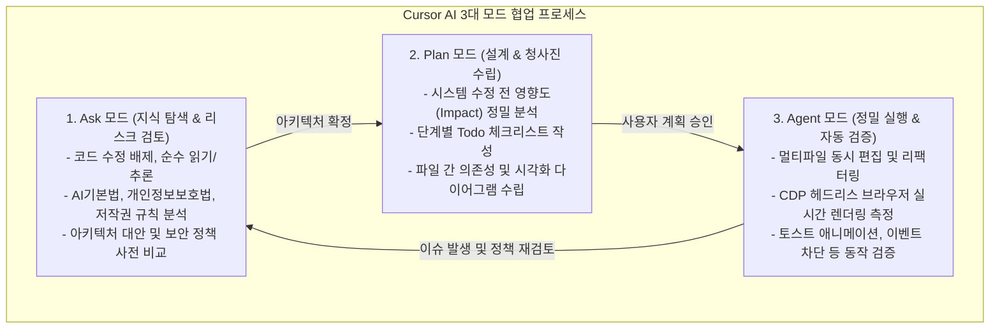

# 제2장. Cursor AI 바이브 코딩 방법론

## 2.1 바이브 코딩(Vibe Coding)의 본질과 패러다임 전환

'바이브 코딩(Vibe Coding)'은 인공지능이 코드를 대필하는 단순 자동완성을 의미하지 않습니다. 바이브 코딩의 본질은 **"사람의 명확한 의도와 아키텍처 설계를 고도화된 자연어 프롬프트로 전달하고, AI 엔진의 연산력과 속도를 활용하여 빠르고 정밀하게 소프트웨어를 조립하며, 그 결과에 대해 인간이 엄격한 품질과 책임을 담보하는 개발 패러다임"**입니다.

본 프로젝트는 기획 단계부터 전체 아키텍처 수립, 코드 작성, 브라우저 실시간 검증, 그리고 기술문서 생태계 구축에 이르는 전 과정을 Cursor AI 환경에서 체계적인 바이브 코딩 방식으로 완수했습니다. 

단순히 "이 기능 만들어 줘" 식의 단발성 요청이 아니라, Cursor가 제공하는 3대 작업 모드(Ask, Plan, Agent)를 유기적으로 전환하며 전통적인 소프트웨어 공학의 엄격함을 AI 기반 개발에 성공적으로 접목했습니다.

---

## 2.2 Cursor AI 3대 모드의 유기적 운용 라이프사이클

Cursor AI 환경의 핵심은 코드 수정 권한과 컨텍스트의 성격에 따라 분리된 3대 모드입니다. 본 프로젝트는 각 모드의 특성을 철저히 지키며 개발을 진행했습니다.

### 1) Ask 모드: 법률·정책적 검토 및 사전 의사결정
- **역할 및 특징**: 프로젝트 코드를 직접 변경하지 않고, 전체 코드베이스와 외부 지식을 탐색하며 질문과 답변, 설계 대안을 심층 토론하는 모드입니다.
- **실제 프로젝트 적용 사례**:
  - **인공지능기본법(2026년 1월 시행)** 및 디지털 관련 법령에 대한 호스팅 영향도 분석
  - 정적 웹사이트에서 third-party 교재·강의 요약의 저작권 공정이용 범위 및 포트폴리오 표기 원칙 논의
  - 공개 GitHub Pages 환경에서 학점은행제 과제 원본에 포함된 타인 개인정보(교수명, 타 학생 학번)의 노출 리스크 식별
  - robots.txt와 TDM(Text and Data Mining) 협약 적용 가능 여부 사전 타당성 검토

### 2) Plan 모드: 영향도 분석과 단계별 실행 청사진 수립
- **역할 및 특징**: 맹목적인 코드 수정을 방지하기 위해 파일 간 종속성을 분석하고, 전체 작업의 순서도와 체크리스트(Todo), 파일 경로 단위의 구체적 변경 계획서를 작성하는 모드입니다.
- **실제 프로젝트 적용 사례**:
  - 하단 전체 사이트맵 전개 및 저작권자 변경 시 5개 독립 HTML과 각각의 CSS에 미치는 영향 분석
  - 정적 사이트 보안 가드(`protect-resources.js`) 추가 시 학습록 대시보드(`app.js`)의 비동기 데이터 fetch와의 로딩 순서 간섭 분석
  - 지금 읽고 계신 '포트폴리오 북 PDF 제작 계획'을 포함하여, 모든 복합 작업에 대해 사전에 구조화된 계획서(`.plan.md`)를 작성하고 승인 후 실행

### 3) Agent 모드: 정밀 멀티파일 편집과 브라우저(CDP) 실시간 검증
- **역할 및 특징**: 파일 시스템 제어, 정규식 치환, 터미널 명령 실행 및 헤드리스 브라우저(Chrome DevTools Protocol)를 통합하여 실제 코드를 수정하고 렌더링 결과를 시각적으로 검증하는 자율 실행 모드입니다.
- **실제 프로젝트 적용 사례**:
  - 5개 HTML 및 4개 CSS 파일 전반의 하단 푸터 및 사이트맵 구조를 병렬 도구 호출로 정확하게 동기화
  - Cursor 내장 브라우저 환경에서 실제 웹페이지를 띄우고(CDP `Runtime.evaluate`), `copy` 이벤트 발생 시 안내 토스트 팝업의 CSS 애니메이션 동작 여부 확인
  - 3D 명함 페이지의 스크롤 위치 이동 및 반응형 모바일 뷰포트에서의 레이아웃 깨짐(Overflow) 실시간 자동 스크린샷 측정

---

## 2.3 프롬프트 엔지니어링과 인간 주도의 품질 책임 원칙

바이브 코딩을 성공으로 이끄는 가장 중요한 요소는 **'지시의 명확성'**과 **'인간의 최종 검수'**입니다.

### 1) 명확한 맥락과 제약 조건의 전달
지원자는 Cursor AI에 명령을 내릴 때 항상 다음과 같은 원칙을 견지했습니다:
- **배경 맥락 제공**: "정적 GitHub Pages 배포 환경이므로 서버 측 세션이나 백엔드 라우터가 없음"
- **명시적 부정 제약(Negative Constraints)**: "학습록 검색창의 키보드 입력은 절대 막지 말 것", "본문 읽기를 방해하는 스크롤 잠금은 절대 하지 말 것"
- **구체적인 산출물 형태 지정**: "반응형 2단 컬럼이 유지되는 펼친 사이트맵", "애니메이션 알림 토스트"

### 2) 문장 생성 원칙과 윤리적 선언
본 프로젝트는 투명한 AI 활용을 위해 전 페이지와 문서에 다음 원칙을 일관되게 명시했습니다:

> **"자료를 제외한 문장이나 문구는 나의 생각을 프롬프트에 요청하여 생성한 문장이나 문구입니다."**

- **생각의 주체는 사람**: 지원자가 어떤 방향으로 커리어를 쌓았고, 어떤 가치관을 지니고 있으며, 어떤 구조로 포트폴리오를 구성할지에 대한 설계와 논리는 100% 사람의 머리에서 나왔습니다.
- **생성의 주체는 AI 프롬프트**: 그 생각을 정제된 문장과 표현으로 다듬는 과정을 Cursor AI 프롬프트를 통해 수행했습니다.
- **자료와의 명확한 분리**: 독서 노트나 학점은행제 과제 등 지원자가 직접 공부하고 정리한 학습 원문(자료)은 AI 문장 생성의 대상에서 명확히 제외하여 진정성을 확보했습니다.
