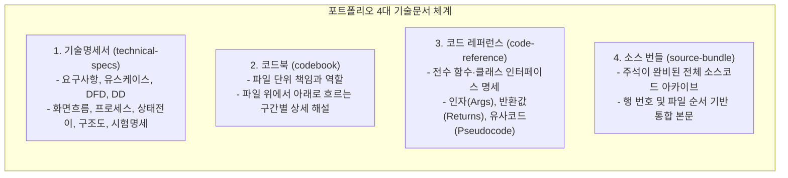

# 제3장. 체계적인 기본 기술문서 체계

## 3.1 소프트웨어 공학 표준을 준수한 4대 기술문서 생태계

일반적인 웹 포트폴리오는 화면 결과물만 보여주고 끝나는 경우가 대부분입니다. 하지만 실무 개발 현장에서 가장 중요한 역량은 **"자신이 작성한 소프트웨어가 어떤 요구사항에 의해 출발했고, 어떤 아키텍처로 설계되었으며, 향후 동료 개발자가 어떻게 유지보수할 수 있는가"**를 명확히 문서화하는 능력입니다.

본 프로젝트는 순수 정적 웹 사이트임에도 불구하고, 대규모 엔터프라이즈 시스템에 필적하는 엄격한 소프트웨어 공학 표준에 맞추어 **4대 기술문서(Technical Documentation Suite)**를 사전에 완벽히 구축해 두었습니다.

---

## 3.2 4대 기술문서별 상세 구성 및 역할

### 1) 기술명세서 (`docs/technical-specs.pdf`, `docs/technical-specs.md`)
소프트웨어 분석 및 설계의 교과서적인 산출물들을 집대성한 핵심 문서입니다.
- **요구사항 명세서 (Requirements)**: 기능 요구사항과 비기능 요구사항(성능, 접근성, 무의존성) 정의
- **유스케이스 다이어그램 및 명세서 (Use Cases)**: 방문자(Visitor)와 작성자(Author)의 액터 분리 및 상호작용 흐름
- **자료 흐름도 (DFD, Data Flow Diagram)**: Level 0 및 Level 1 DFD를 통해 원본 텍스트가 빌드 스크립트를 거쳐 대시보드 데이터로 가공되는 파이프라인 시각화
- **자료 사전 (DD, Data Dictionary)**: 카탈로그 JSON 구조, 청크 포맷, `localStorage` 키-값 정의
- **화면 흐름도 (Screen Flow)**: 5대 페이지 및 서브 섹션 간의 이동 경로 및 트랜지션
- **프로세스 명세서 (Process Specification)**: 검색 엔진 필터링 알고리즘, 개인정보 마스킹 로직의 구조화된 기술
- **상태 전이도 (State Transition)**: 다크/라이트 테마 변경 및 요약/원본 모달 팝업 상태 변화도
- **구조도 (Structure Chart)**: 모듈 간의 호출 관계와 데이터 전달 흐름
- **시험 명세서 (Test Specification)**: 화면 반응형 테스트, 키보드 접근성 테스트, 검색 결과 일치성 시험 케이스

### 2) 코드북 (`docs/codebook.pdf`, `docs/codebook.md`)
코드를 처음 접하는 개발자가 프로젝트를 한눈에 파악할 수 있도록 '파일 읽는 가이드' 역할을 수행합니다.
- **대상 범위**: 메인 포털, 이력서, 프로필, 3D 온라인 명함, 학습록 대시보드 및 빌드 파이프라인
- **해설 포맷**: 각 파일의 단일 책임(Single Responsibility) 정의 -> 추천 읽는 순서 -> 코드 구간별 논리 해설 -> 연계 파일 매핑

### 3) 코드 레퍼런스 (`docs/code-reference.pdf`, `docs/code-reference.md`)
모든 JavaScript 및 Python 함수/클래스를 망라한 표준 API 참조 문서입니다.
- **함수 시그니처**: 함수명, 인자 타입, 반환값 타입 명시
- **기능 요약**: 해당 함수가 해결하는 구체적인 문제 정의
- **유사코드(Pseudocode)**: 언어에 구애받지 않고 동작 알고리즘을 직관적으로 이해할 수 있는 슈도코드 수록

### 4) 소스 번들 (`docs/source-bundle.pdf`, `docs/source-bundle.html`)
프로젝트를 구성하는 모든 프로덕션 코드와 빌드 스크립트를 주석과 함께 하나의 거대한 문서로 병합한 아카이브입니다.
- 파일 순서대로 정렬되어 있으며, 각 줄마다 명확한 행 번호가 매겨져 있습니다.
- 학점은행제 과제의 민감 데이터나 방대한 원문 데이터는 제외하고, 오직 엔지니어링 산출물에 해당하는 핵심 소스만을 엄선하여 컴파일했습니다.

---

## 3.3 문서 자동화 빌드 파이프라인 (Build Pipeline)

본 프로젝트의 기술문서들은 사람이 일일이 워드 프로세서로 작성한 정적 파일이 아닙니다. 변경 사항이 발생하면 즉시 코드를 파싱하고 마크다운을 결합하여 PDF로 자동 렌더링하는 전용 파이썬 빌더들이 뒷받침하고 있습니다.

| 빌더 스크립트 | 생성 산출물 | 핵심 동작 방식 |
| :--- | :--- | :--- |
| `docs/build_specs.py` | `technical-specs.pdf` | 마크다운 내 Mermaid 코드를 파싱하여 Edge 헤드리스 브라우저로 렌더링하고 이미지 잘라내기 후 A4 PDF 출력 |
| `docs/build_codebook.py` | `codebook.pdf` | 챕터별 마크다운을 통합하고 인쇄용 CSS를 적용하여 고화질 한글 PDF 변환 |
| `docs/build_code_reference.py` | `code-reference.pdf` | 소스 내 독스트링(Docstring)과 주석을 정규식으로 파싱하여 API 레퍼런스 자동 생성 |
| `docs/build_source_bundle.py` | `source-bundle.pdf` | 전수 소스 파일에 주석을 보강하고 문법 하이라이팅 스타일을 입혀 단일 PDF로 묶음 |
| `docs/build_portfolio_book.py` | `portfolio-book.pdf` | 본 포트폴리오 북의 챕터들을 통합하여 표지, 목차, 인쇄 스타일이 완비된 단행본 PDF 생성 |

이러한 문서 자동화 파이프라인은 코드가 수정되었을 때 문서가 뒤처지는 '문서화의 지연(Documentation Drift)' 문제를 근본적으로 방지합니다.
