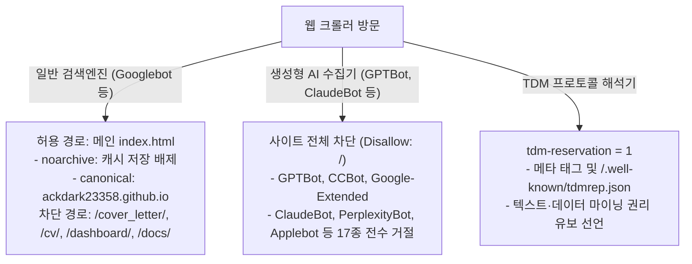

# 제5장. 정적 배포 환경의 보안·거버넌스 및 SEO 전략

## 5.1 정적 호스팅(GitHub Pages)의 보안적 한계 인식

GitHub Pages는 전 세계 개발자들이 애용하는 훌륭한 무료 정적 호스팅 플랫폼입니다. 그러나 백엔드 서버를 직접 제어할 수 없다는 태생적 한계로 인해 다음과 같은 보안적 취약점이 존재합니다:

- **서버 측 인증 불가**: HTTP Basic Auth나 서버 세션을 통한 비인가 방문자 차단 불가능
- **커스텀 응답 헤더 설정 불가**: `X-Frame-Options`, `Content-Security-Policy(CSP)` 등의 헤더를 웹 서버 레벨에서 강제할 수 없음
- **공개 저장소 파일의 직접 노출**: 브라우저 스크립트와 무관하게 `raw.githubusercontent.com`이나 Git clone을 통한 소스 접근 가능

본 프로젝트는 이러한 정적 환경의 한계를 명확히 인지하고, **"정상적인 웹 브라우징 경로에서 발생할 수 있는 무단 스크랩, 피싱 목적의 악의적 사이트 임베딩, 그리고 생성형 AI의 무분별한 데이터 수집을 방지하는 클라이언트 거버넌스 레이어"**를 꼼꼼하게 구축했습니다.

---

## 5.2 클라이언트 사이드 리소스 보호 레이어 (`protect-resources.js`)

본 프로젝트의 모든 공개 웹 페이지에는 전용 보안 스크립트인 `protect-resources.js`가 즉시 실행 함수(IIFE) 형태로 탑재되어 있습니다.

### 1) 호스트 화이트리스트 검증 및 비인가 배포 차단
- **허용 호스트 목록**: `ackdark23358.github.io`, `localhost`, `127.0.0.1`만을 정당한 실행 도메인으로 허용합니다.
- **불법 미러링 차단**: 제3자가 저장소 코드를 무단으로 포크하여 타 도메인에 호스팅할 경우, 스크립트가 도메인을 검사하여 전체 화면을 검은 배경으로 바꾸고 **"자료에 대해서 퍼가는 것을 방지하였습니다."** 안내만을 출력하며 모든 콘텐츠 렌더링을 중단합니다.

### 2) 클릭재킹(Clickjacking) 및 iframe 임베딩 방지
- 악의적인 피싱 사이트나 프레임워크가 본 포트폴리오를 `<iframe>` 안에 삽입하여 마치 자신의 사이트인 양 속이는 행위를 방지하기 위해 `window.top !== window.self` 검사를 수행합니다.
- 프레임에 갇혀 실행되는 것이 감지되면 즉시 페이지 본문을 지우고 차단 안내 화면으로 전환합니다.

### 3) 무단 텍스트 복사·스크랩 방지 및 애니메이션 토스트
- 페이지 전반에 `user-select: none`을 기본 적용하여 마우스 드래그를 차단합니다. (단, 학습록 대시보드의 검색창 `<input>`은 정상적인 키보드 타이핑이 가능하도록 예외 처리)
- `copy`, `cut`, `contextmenu`(우클릭), `dragstart`, 단축키(`Ctrl+C`, `Ctrl+X`, `Ctrl+A`, `Ctrl+S`, `Ctrl+U`) 이벤트를 감지하여 기본 동작을 취소(`e.preventDefault()`)합니다.
- 차단 발생 시 화면 중앙 하단에 **"자료에 대해서 퍼가는 것을 방지하였습니다."**라는 메시지가 부드럽게 솟아올랐다 사라지는 2.6초 CSS 팝업 애니메이션(`resource-protect-pop`)을 표출하여 방문자에게 친절하면서도 단호한 피드백을 제공합니다.
- **가독성 보장**: 불필요한 스크롤 잠금은 절대 하지 않아, 정상적인 열람과 학습은 얼마든지 쾌적하게 가능합니다.

### 4) 과제 원본 데이터 내 개인정보(PIPA) 마스킹
- 학점은행제 과제 원본 파일에 포함되어 있던 담당 교수 성함, 타 학생 학번, 민감한 개인 식별 정보는 대시보드 렌더링 함수(`maskAssignmentPrivacy`)를 통해 `*** 교수님`, `*** 학번` 형태로 마스킹 처리하여 개인정보보호법을 준수합니다.

---

## 5.3 검색엔진 최적화(SEO)와 AI 크롤링 방지(GEO/TDM)의 조화

포트폴리오의 가치는 구직 시장에서 채용 담당자나 기업 검색엔진에는 잘 노출되어야 하지만, 동시에 상업적 AI 기업의 데이터 학습용 크롤러나 무단 복제 봇에는 학습 재료로 착취되지 않아야 합니다. 이를 위해 정교한 검색 거버넌스를 설계했습니다.

### 1) 일반 검색엔진(SEO) 대상 정책
- **메인 포털 노출**: 메인 자기소개서(`index.html`)는 `robots=index, follow`를 부여하여 구글 등 주요 검색엔진에서 '김신욱', '코탐록' 등으로 검색될 수 있도록 지원합니다.
- **캐시 복사본 저장 금지 (`noarchive`)**: 검색 결과 리스트에는 제목과 스니펫이 나오되, 검색엔진 서버에 원문 전체 캐시가 영구 저장되어 돌아다니는 것을 차단합니다.
- **표준 URL 지정 (`canonical`)**: `https://ackdark23358.github.io/`를 대표 주소로 명시하여 중복 색인을 방지합니다.
- **내부 자료 디렉터리 배제**: `robots.txt`를 통해 상세 프로필, 이력서, 3D 명함, 학습록 대시보드, 기술문서(`docs/`) 디렉터리는 일반 검색엔진의 무분별한 딥 크롤링에서 제외했습니다.

### 2) 생성형 AI 및 LLM 크롤러(GEO) 전면 차단
- **AI 봇 식별 전수 차단**: OpenAI(`GPTBot`, `ChatGPT-User`, `OAI-SearchBot`), Google(`Google-Extended`), Anthropic(`ClaudeBot`, `anthropic-ai`, `Claude-Web`), Perplexity(`PerplexityBot`), Common Crawl(`CCBot`), ByteDance(`Bytespider`), Meta(`meta-externalagent`), Cohere, Diffbot 등 현존하는 주요 AI 수집 봇 17종에 대해 사이트 전체 루트(`Disallow: /`) 차단 규칙을 부여했습니다.
- **TDM(Text and Data Mining) 권리 유보 프로토콜 준수**:
  - 전 페이지 `<head>`에 `<meta name="tdm-reservation" content="1">` 선언
  - 웹 표준 루트 경로에 `/.well-known/tdmrep.json`을 배포하여 인공지능 학습 목적의 데이터 마이닝을 공식 거절함을 머신러닝 에이전트에 명시했습니다.
