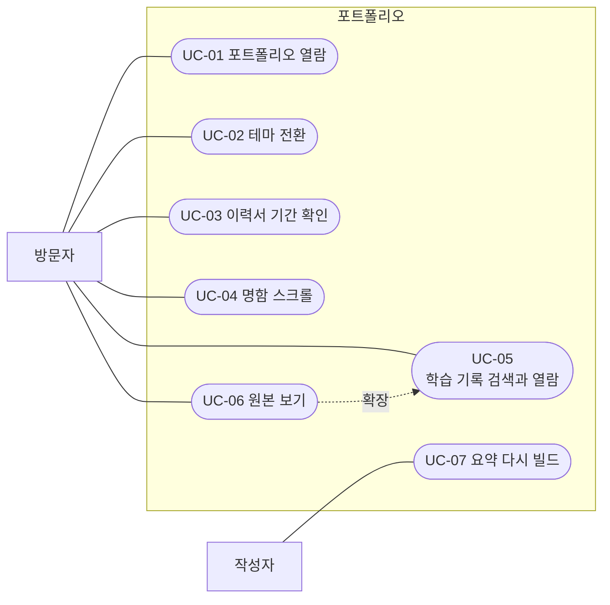

# 유스케이스

행위자는 방문자와 작성자다. 기본 흐름은 성공한 경우이고, 대안 흐름은 빠지거나 실패하는 경우다.

## 유스케이스 다이어그램

사람 그림은 행위자이고, 타원은 유스케이스다. 가운데 상자는 시스템 경계다. 실선은 행위자의 수행이고, 점선은 확장이다. 원본 보기는 학습 기록 열람이 열린 뒤에 선택된다.

단계로 보면 다음과 같다.

1. 방문자는 포트폴리오 열람, 테마 전환, 이력서 기간 확인, 명함 스크롤, 학습 기록 검색과 열람, 원본 보기를 수행한다.
2. 작성자는 요약 다시 빌드를 수행한다.
3. 원본 보기는 학습 기록 검색과 열람을 확장한다. 요약 모달의 원본 링크에서만 이어진다.

## UC-01 포트폴리오 열람

- 행위자: 방문자
- 사전조건: `index.html`을 열 수 있다.
- 기본 흐름: 방문자가 절 링크를 누른다. 해당 절로 스크롤된다. 자료 메뉴나 자료 카드에서 자기소개, 명함, 이력서, 학습 기록 중 하나로 이동한다.
- 대안 흐름: 링크의 대상 절이 없으면 기본 이동을 막지 않고 그 클릭은 무시된다.
- 사후조건: 보려는 화면 또는 절이 열려 있다.

## UC-02 테마 전환

- 행위자: 방문자
- 사전조건: 테마 버튼이 있는 페이지다.
- 기본 흐름: 저장된 테마가 있으면 그것을 적용한다. 없으면 페이지의 기본 테마를 적용한다. 버튼을 누르면 라이트와 다크가 바뀌고 저장된다.
- 대안 흐름: 저장소를 쓸 수 없으면 현재 페이지만 바뀐다.
- 사후조건: `html`의 `data-theme`와 버튼 안내 문구가 현재 테마와 같다.

## UC-03 이력서 기간 확인

- 행위자: 방문자
- 사전조건: 이력서에 시작일이 있는 경력 항목이 있다.
- 기본 흐름: 페이지가 준비되면 시작일과 종료일의 차이를 연·개월로 계산해 기간 자리에 괄호로 넣는다.
- 대안 흐름: 종료일이 today이면 오늘 날짜를 종료일 자리에 표시한 뒤 계산한다. 시작일이 비어 있으면 그 항목은 건너뛴다. 1년 미만이고 1개월 미만이면 하이픈을 보여 준다.
- 사후조건: 기간 문자열이 화면에 있다.

## UC-04 명함 스크롤

- 행위자: 방문자
- 사전조건: 온라인 명함 페이지다.
- 기본 흐름: 스크롤 진행률 0에서 0.5까지 명함이 뒤집힌다. 0.5에서 1까지 화면을 덮도록 커진다. 이력 절이 20% 이상 보이면 표시 클래스가 붙는다.
- 대안 흐름: 스크롤을 위로 올리면 이력 절의 표시 클래스가 빠진다. 24px보다 많이 내리면 스크롤 안내가 숨는다.
- 사후조건: 카드 transform이 현재 스크롤과 맞다.

## UC-05 학습 기록 검색과 열람

- 행위자: 방문자
- 사전조건: 대시보드에 `window.SITE_DATA.catalog`가 있다.
- 기본 흐름: 소개 문구와 건수가 채워지고 카드가 그려진다. 검색어를 입력하면 맞는 카드만 남는다. 카드를 누르면 요약 모달이 열린다.
- 대안 흐름: 검색 결과가 없으면 빈 상태 문구가 보인다. 카탈로그가 없으면 빌드 안내가 보인다. 해당 요약 HTML이 없으면 모달에 오류 문구가 보인다.
- 사후조건: 모달이 열려 있거나, 빈 결과·오류 안내가 보인다.

## UC-06 원본 보기

- 행위자: 방문자
- 사전조건: 요약 모달 안에 원본 링크가 있다.
- 기본 흐름: 링크를 누르면 원본 보기가 열리고 텍스트를 불러온다. 한 번 받은 텍스트는 캐시에 둔다. 닫으면 원본 보기만 사라지고, 요약 모달이 남아 있으면 스크롤 잠금은 유지된다.
- 대안 흐름: JSON을 찾지 못하면 빌드 재실행 안내가 보인다. 경로가 과제 폴더면 개인정보를 가린 뒤 보여 준다. HTML 파일이면 태그를 뺀 평문으로 보여 준다.
- 사후조건: 원본 텍스트 또는 오류 안내가 원본 보기에 있다.

## UC-07 요약 다시 빌드

- 행위자: 작성자
- 사전조건: `study_note_record_organization`에서 파이썬을 실행할 수 있고, `data/`에 노트와 과제 문서가 있다.
- 기본 흐름: `python scripts/build_output.py`를 실행한다. 학습 42그룹과 과제 카탈로그가 만들어지고, 요약 마크다운과 `catalog.json`이 쓰인 뒤 `build_static_site.py`가 `data.js`, 원본 JSON, 히어로 목록을 갱신한다.
- 대안 흐름: 학습 그룹 수가 42가 아니면 `output/study-audit.txt`를 남기고 중단한다. `catalog.json`이 없는데 정적 빌드만 실행하면 중단한다. 결과 파일이 크기 한도를 넘으면 중단한다.
- 사후조건: 대시보드가 새 카드와 원본을 읽을 수 있다.
