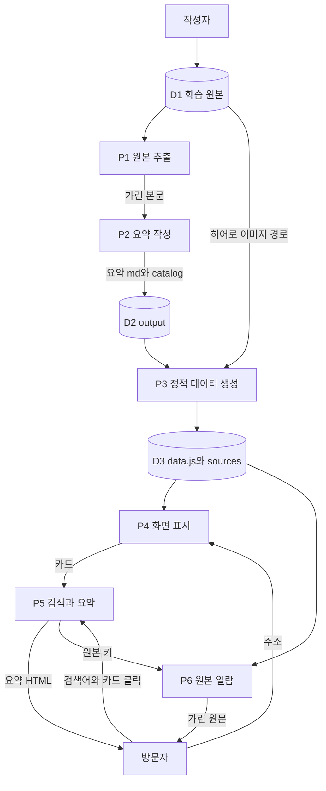

# 자료 흐름도 (DFD)

외부 실체는 방문자와 작성자다. 자료 저장소는 학습 원본, 빌드 산출, 대시보드가 읽는 정적 데이터다.

## 배경도

작성자가 원본을 빌드에 넣고, 빌드 결과가 브라우저를 거쳐 방문자에게 보인다. 방문자는 브라우저에 검색어와 클릭을 보내고 화면을 받는다.

단계로 보면 다음과 같다.

1. 작성자가 `data/`의 노트·과제 문서와 빌드 명령을 시스템에 넣는다.
2. 시스템이 요약과 정적 데이터를 만든다.
3. 방문자가 브라우저에서 페이지를 열고 검색·클릭을 보낸다.
4. 시스템이 화면과 원본 텍스트를 돌려준다.

## 레벨 1

프로세스 여섯 개다. P1부터 P3은 작성자 빌드이고, P4부터 P6은 방문자 화면이다.

단계로 보면 다음과 같다.

1. P1은 D1에서 텍스트, 워드, PDF, HTML 본문을 뽑고 비밀 값과 과제 개인정보를 가려 D2의 추출 캐시에도 둔다.
2. P2는 그 본문으로 학습·과제 요약 마크다운과 `catalog.json`을 D2에 쓴다.
3. P3은 D2의 요약을 HTML로 바꾸고, 원본 링크가 가리키는 본문을 D3의 JSON으로 나누어 저장한다. 카드 목록은 `data.js`에 둔다.
4. P4는 D3을 읽어 소개 문구와 히어로, 카드 그리드를 그린다.
5. P5는 검색어로 카드를 거르고, 클릭한 카드의 요약 HTML을 모달에 넣는다.
6. P6은 원본 키로 D3의 JSON을 찾아 평문으로 보여 준다. 과제 키이면 한 번 더 가린다.
