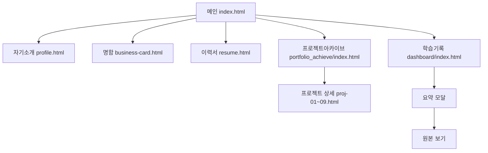

# 화면 흐름

화면은 여섯이다. 메인이 허브이고, 나머지 다섯은 자료 메뉴와 본문 카드로 연결된다. 각 화면은 같은 테마 저장 키를 읽는다.

단계로 보면 다음과 같다.

1. 방문자는 메인에서 절 앵커로 본문을 이동하거나 자료 화면으로 나간다.
2. 자기소개, 명함, 이력서는 각 페이지 안에서 스크롤로 내용을 본다.
3. 학습 기록은 카드 그리드에서 요약 모달로, 모달의 링크에서 원본 보기로 들어간다.
4. 프로젝트 아카이브는 카드로 프로젝트를 살펴보고, 개별 프로젝트 상세 페이지로 들어가 실행 화면과 코드를 본다.
5. 원본 보기를 닫으면 요약 모달로 돌아온다. 요약을 닫으면 그리드로 돌아온다.

## 메인

절은 지원 동기, 성장·학습, 역량, 강점, 마치며, 참고다. 자료 메뉴와 본문 카드의 목적지는 같다.

- 자기소개: `cover_letter/profile.html`
- 온라인 명함: `online_business_card/business-card.html`
- 이력서: `cv/resume.html`
- 학습 기록: `study_note_record_organization/dashboard/index.html`
- 프로젝트 아카이브: `portfolio_achieve/index.html`

좁은 화면에서는 상단 메뉴가 접혀 있다가 햄버거 버튼으로 열린다.

## 자기소개

사이드 메뉴가 현재 보이는 절을 활성으로 표시한다. 맨 위로 버튼이 문서 처음으로 스크롤한다.

## 온라인 명함

한 페이지 스크롤이다. 위쪽은 명함 변환, 아래쪽은 이력 절이다. 다른 페이지로 가는 링크는 상단 헤더에 있다.

## 이력서

경력 항목의 날짜를 읽은 뒤 기간 문자열을 채운다. 별도 모달은 없다.

## 학습 기록

처음 화면은 소개, 검색 입력, 카드 그리드, 히어로다. 카드를 누르면 요약 모달이 그리드 위에 겹친다. 원본 링크를 누르면 원본 보기가 그 위에 겹친다. Escape는 원본 보기가 열려 있으면 그것만 닫고, 아니면 요약 모달을 닫는다.
