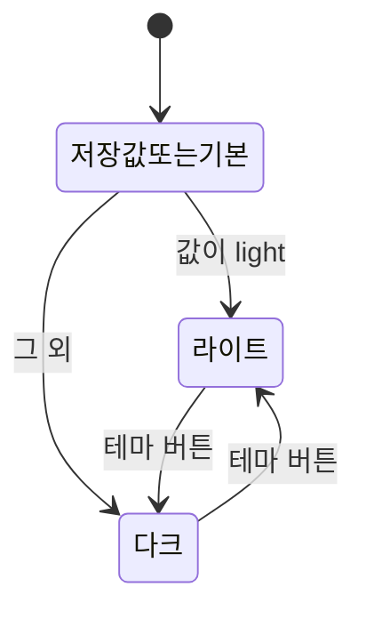
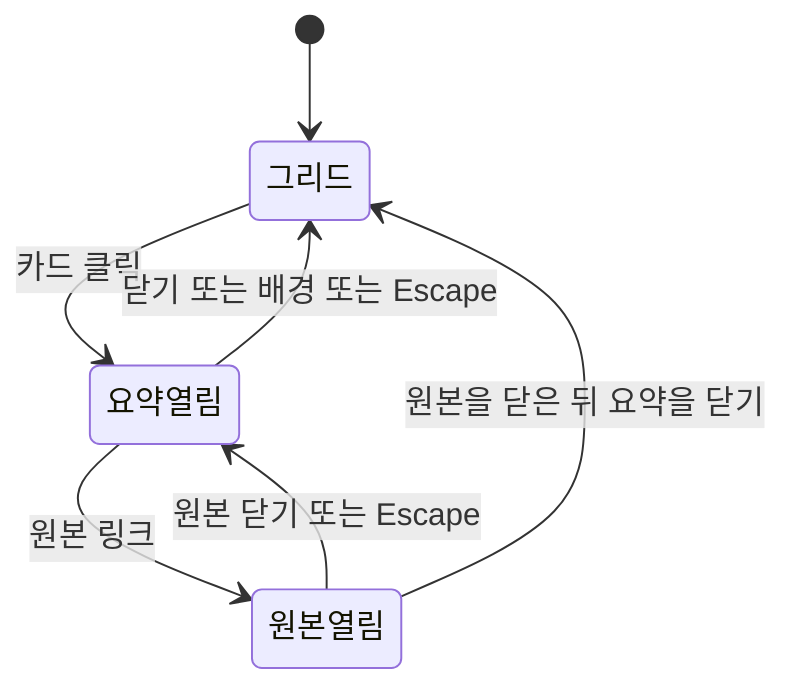

# 상태 전이

상태가 바뀌는 화면 요소만 적는다. 이력서 기간 계산은 페이지 로드 때 한 번 끝나고 이후 상태가 없다.

## 테마

상태는 라이트와 다크다.

단계로 보면 다음과 같다.

1. 페이지를 그리기 전에 저장값을 읽어 `data-theme`에 넣는다.
2. 버튼은 현재가 다크면 라이트로, 라이트면 다크로 바꾼다.
3. 다른 탭이 같은 키를 바꾸면 이 탭도 그 값으로 맞춘다.
4. 저장에 실패하면 메모리와 화면만 바뀌고 다음 방문에는 기본값으로 돌아간다.

## 모바일 메뉴

상태는 닫힘과 열림이다. 넓은 화면에서는 닫힘이 유지된다.

1. 햄버거 버튼이 닫힘과 열림을 뒤집는다.
2. 열림 패널은 `calc(100dvh - 헤더 높이)`까지 펼치고, 내용이 더 길면 패널 자체를 세로 스크롤한다.
3. 열림에서 Escape를 누르면 닫히고 버튼으로 포커스가 돌아간다.
4. 너비가 768px보다 커지면 닫힌다.
5. 닫힐 때 자료 드롭다운도 닫힌다.
6. 동작 줄이기가 켜져 있으면 절 이동 스크롤만 즉시 이루어지고, 메뉴 상태 전이는 같다.

## 자료 드롭다운

각 드롭다운은 닫힘 또는 열림이다.

1. 버튼을 누르면 다른 드롭다운은 닫고 이 드롭다운만 연다. 이미 열려 있으면 닫는다.
2. 좁은 화면에서 열 때 드롭다운 하단이 패널 밖으로 나가면 `#site-nav` 스크롤을 조정해 **프로젝트 아카이브** 등 마지막 항목까지 보이게 한다.
3. 메뉴 밖을 누르거나 Escape를 누르면 모두 닫힌다.
4. 항목을 누르면 필요하면 절로 스크롤한 뒤 드롭다운과 모바일 메뉴를 닫는다.

## 요약 모달과 원본 보기

둘은 따로 닫힌다. 원본 보기는 요약 위에 겹칠 수 있다.

단계로 보면 다음과 같다.

1. 요약이 열리면 배경 스크롤이 잠긴다.
2. 원본이 그 위에 열리면 요약 쪽 클릭은 막히고, 스크롤 잠금은 유지된다.
3. 원본만 닫히면 요약이 다시 클릭되고, 스크롤은 요약이 열려 있으므로 잠긴 채다.
4. 요약까지 닫히고 원본도 없으면 스크롤 잠금이 풀린다.
5. 원본 텍스트를 불러오는 동안 본문은 로딩 문구다. 실패하면 오류 문구로 바뀐다. 성공하면 본문으로 바뀐다. 이 세 표시는 원본열림 안의 하위 상태다.

## 히어로

상태는 숨김, 표시, 전환중이다.

1. 이미지 목록이 비어 있으면 숨김으로 가고 끝난다.
2. 목록이 있으면 첫 장을 표시한다.
3. 클릭 또는 타이머가 다른 장을 고르면 전환중이 된다. 숨겨 둔 이미지의 로드가 끝나면 표시로 돌아와 보이는 장이 바뀐다.
4. 로드에 실패하면 전환중만 풀고 장은 유지한다.
5. 동작 줄이기이거나 이미지가 한 장이면 타이머는 없다. 클릭 전이는 이미지가 두 장 이상일 때만 다른 장으로 간다.
