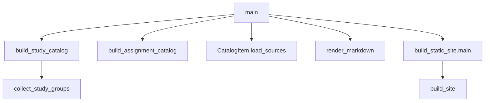
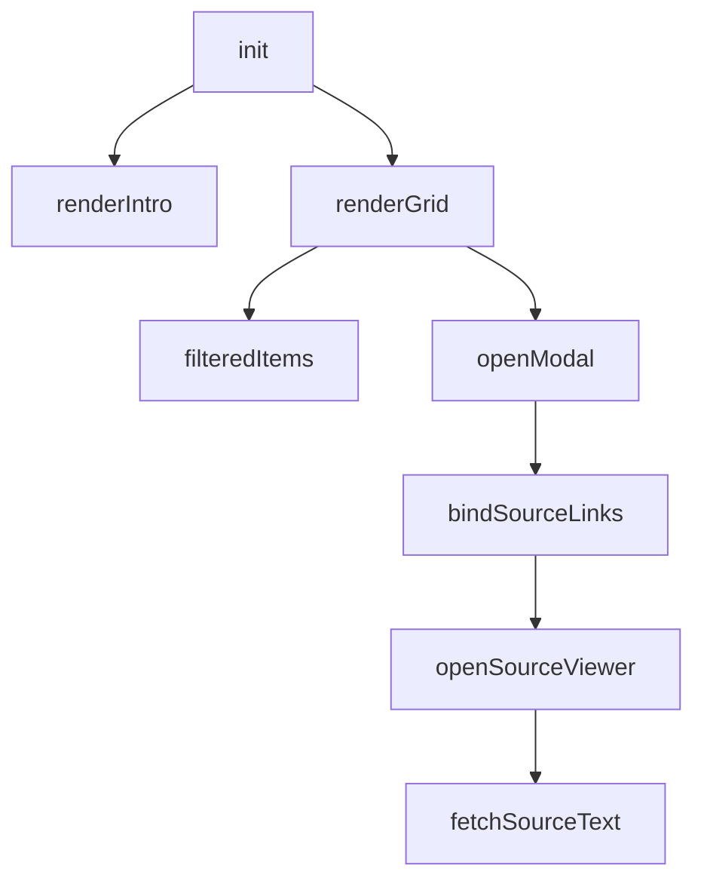

# 구조도

위가 호출하는 쪽이고 아래가 호출되는 쪽이다. 이름 있는 함수만 적는다. 익명 콜백은 그 함수의 안에 있다.

## 빌드

`extract_sources.py`는 `build_output.main`만 호출한다.

단계로 보면 다음과 같다.

1. `main`이 학습 카탈로그와 과제 카탈로그를 만든다.
2. `collect_study_groups`는 파일 이름을 과목으로 묶고 장·강 순으로 정렬한다.
3. `load_sources`가 원본 본문을 채운다.
4. `render_markdown`이 카드 하나의 요약 파일을 만든다. 윈도우 프로그래밍1만 화면 설명용 별도 형식을 탄다.
5. `main`이 정적 사이트 `main`을 부르고, 그 안의 `build_site`가 `data.js`와 원본 JSON을 쓴다.

`build_site` 아래의 주요 호출은 `collect_catalog`, `parse_frontmatter`, `md_to_html`, `rewrite_source_links`, `read_source_text`, `write_hero_images_js`다. 가리기는 `mask_secrets`와 `mask_assignment_privacy`가 담당한다.

## 학습 기록 화면

페이지 로드가 `init`을 부른다.

단계로 보면 다음과 같다.

1. `init`이 데이터를 읽고 소개와 그리드를 그린다.
2. `renderGrid`는 `filteredItems`로 걸러진 카드만 만든다. 카드 클릭이 `openModal`이다.
3. `openModal`이 요약 HTML을 넣은 뒤 `bindSourceLinks`로 원본 링크를 연결한다.
4. 링크 클릭이 `openSourceViewer`이고, 그 함수가 `fetchSourceText`로 JSON을 가져온다.
5. 닫기 함수 `closeModal`, `closeSourceModal`은 위 호출 나무의 형제다. 버튼, 배경 클릭, Escape가 부른다.

## 다른 화면

메인 페이지는 문서 준비가 끝나면 `initSmoothNav`, `initResourceDropdown`, `initThemeToggle`, `initSectionTargets`를 한 번씩 부른다. 이력서는 `fillCareerPeriods` 하나다. 자기소개는 `initScrollSpy`와 `initToTop`이다. 명함은 `updateAnimation`이 스크롤마다 호출된다. 히어로는 `initHero`가 이미지 교체 함수들을 안에 둔다.
