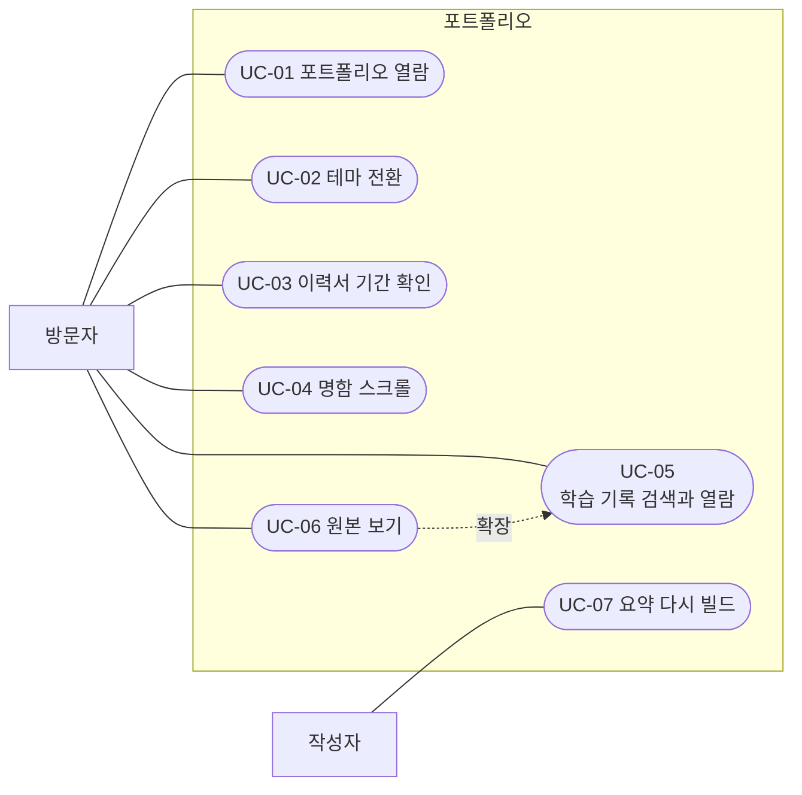
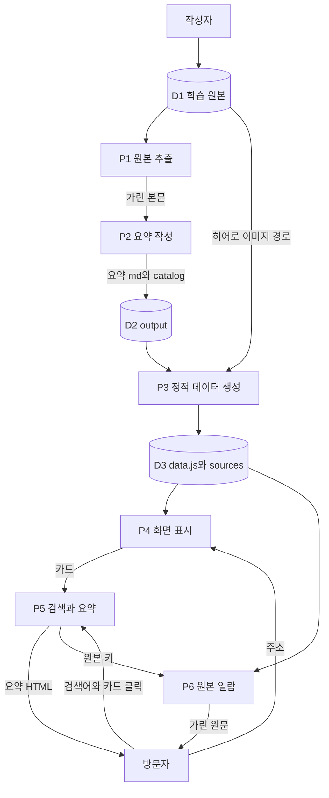
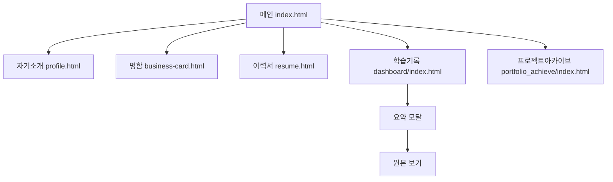
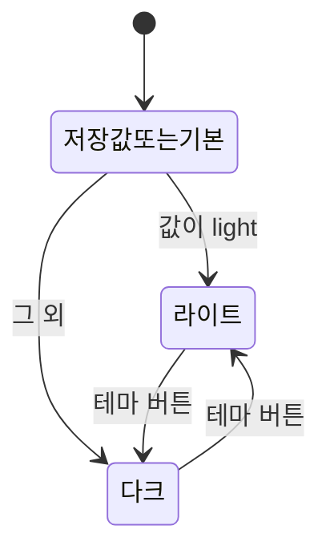
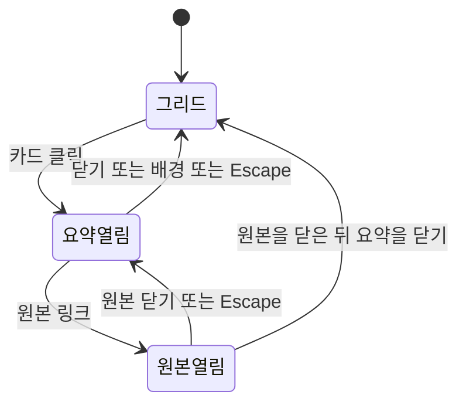
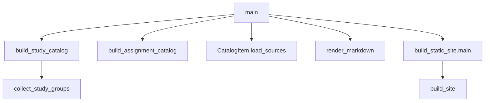
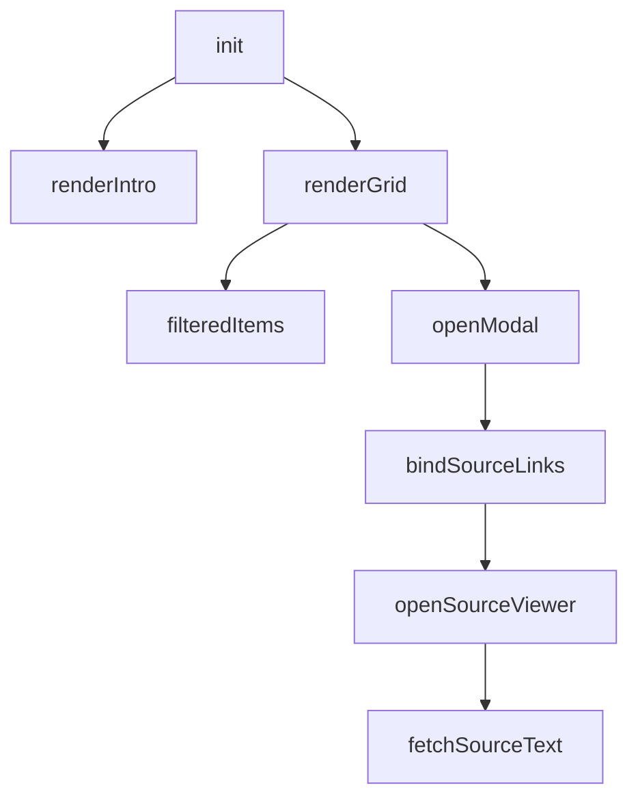

# 기술명세

이 저장소는 취업 지원용 정적 웹 사이트다. 방문자는 포트폴리오 메인, 이력서, 자기소개, 온라인 명함, 학습 기록 대시보드를 본다. 작성자는 학습 노트와 과제 문서를 요약 마크다운과 대시보드 데이터로 다시 만든다.

서버 프로세스는 없다. 브라우저가 HTML, CSS, JS를 읽고, 대시보드 데이터는 파이썬 스크립트가 미리 만들어 둔다. `data/` 안의 과제 프로그램 소스 코드는 이 명세의 대상이 아니다.

함수와 클래스의 줄 단위 설명은 `docs/code-reference.md`에 있다. 이 묶음은 요구부터 시험까지의 기술문서다.

## 읽는 순서

1. 요구사항 명세
2. 유스케이스
3. 자료 흐름도 (DFD)
4. 자료 사전 (DD)
5. 화면 흐름
6. 프로세스 명세
7. 상태 전이
8. 구조도
9. 시험 명세

## 행위자

- 방문자: 브라우저로 페이지를 연다.
- 작성자: 저장소에서 빌드 스크립트를 실행한다.

# 요구사항 명세

## 목적

방문자가 지원 동기, 이력, 자기소개, 명함, 학습·과제 기록을 한 사이트에서 읽고, 작성자가 학습 원본이 바뀌면 요약과 대시보드 데이터를 다시 만들 수 있어야 한다.

## 범위

- 포함: `index.html`, `cv/`, `cover_letter/`, `online_business_card/`, `study_note_record_organization/dashboard/`, `study_note_record_organization/scripts/`, `portfolio_achieve/`
- 제외: `data/` 안의 과제 프로그램 코드, Visual Studio 생성물, 이미 만들어진 `output/` 원문을 사람이 고치는 일

## 기능 요구

- FR-01 메인 화면은 지원 동기, 성장·학습, 역량, 강점, 마치며, 참고 절로 이동할 수 있다. 페이지 안 링크는 해당 절의 처음으로 스크롤하고, 그 절이 키보드 포커스를 받을 수 있다.
- FR-02 자료 메뉴에서 자기소개, 온라인 명함, 이력서, 학습 기록 대시보드, 프로젝트 아카이브로 이동할 수 있다.
- FR-03 좁은 화면(768px 이하)에서는 햄버거 버튼으로 메뉴를 열고 닫는다. 열린 패널 높이는 뷰포트(`100dvh` − 헤더)까지 허용하고, 항목이 더 길면 패널 안에서 세로 스크롤한다. **자료** 드롭다운을 펼치면 하위 링크(프로젝트 아카이브 포함)가 잘리지 않도록 패널 스크롤을 맞춘다. Escape 또는 768px보다 넓은 화면에서는 메뉴가 닫힌다.
- FR-04 테마는 라이트와 다크 두 가지다. 선택한 값은 `portfolio-theme-v2`로 저장되고, 다음 방문과 다른 탭에 반영된다. 저장소를 쓸 수 없으면 현재 페이지만 유지한다.
- FR-05 이력서의 각 경력 항목은 시작일과 종료일로 재직 기간을 계산해 보여 준다. 종료일이 today이면 오늘 날짜로 바꾼다.
- FR-06 온라인 명함은 스크롤 진행률에 따라 앞 절반에서 뒤집히고, 뒤 절반에서 확대된다. 조금 내리면 스크롤 안내가 숨는다. 이력 절이 화면에 들어오면 나타나고, 벗어나면 다시 숨는다.
- FR-07 학습 기록 대시보드는 카드 수, 학습 수, 과제 수, 총 기록 수를 보여 준다.
- FR-08 검색어는 제목, 요약, 종류, 태그에 포함된 카드만 남긴다. 결과가 없으면 빈 상태 문구를 보여 준다.
- FR-09 카드를 누르면 요약 모달이 열리고 페이지 스크롤이 잠긴다. 닫으면 스크롤이 다시 열린다. 요약 HTML이 없으면 오류 문구를 보여 준다.
- FR-10 요약 안의 원본 링크는 원본 보기를 연다. HTML 원본은 평문으로 바꾸고, 과제 원본은 지도교수 이름과 학번을 가린다. 데이터베이스 총괄과제에는 ER 다이어그램을 덧붙인다.
- FR-11 원본 JSON을 찾지 못하면 정적 사이트 빌드를 다시 실행하라는 안내를 보여 준다. `data.js`가 없으면 같은 취지의 안내를 그리드에 보여 준다.
- FR-12 히어로에 이미지가 있으면 두 장을 번갈아 보여 준다. 클릭하면 다른 장으로 넘긴다. 이미지가 없으면 히어로 구역을 숨긴다.
- FR-13 작성자가 `python scripts/build_output.py`를 실행하면 학습·과제 요약 마크다운, `catalog.json`, `index.md`가 갱신되고 이어서 정적 사이트 데이터가 만들어진다.
- FR-14 빌드는 본문의 API 키·토큰 패턴을 고정 마스크로 바꾼다. 과제 본문의 학번과 지도교수 표기도 가린다.
- FR-15 만들어지는 `data.js`와 원본 JSON 한 파일은 GitHub 한 파일 크기 한도를 넘으면 빌드가 중단된다.
- FR-16 리소스 보호 스크립트는 인가되지 않은 호스트나 iframe 환경에서 본문 대신 차단 안내를 표시하고, 복사·우클릭 시 애니메이션 토스트를 띄운다. 검색창 입력은 차단하지 않는다.
- FR-17 사이트 루트의 `robots.txt`는 일반 검색로봇의 자료 경로(`portfolio_achieve/` 포함) 수집을 배제하고 17종의 인공지능 학습 수집기를 차단하며, `.well-known/tdmrep.json`으로 TDM 권리 유보를 알린다.
- FR-18 문서 생성 스크립트는 마크다운 챕터와 Mermaid 다이어그램을 통합하여 단행본 `portfolio-book.pdf`를 빌드한다.
- FR-19 6대 공개 페이지 하단에는 전개형 사이트맵과 저작권 표기(`김신욱(깃허브 ackdark23358)`), AI 문장 생성 선언문을 일관되게 표시한다.
- FR-20 프로젝트 아카이브는 PROJ_01부터 PROJ_17까지 총 17개(실습·기관 과정·Cursor 바이브 코딩 완성 프로젝트)를 동일 구조의 메타 카드(사용 도구, 실행 환경, 간단 설명, 핵심 기능)로 제공하며, 별도 외부 페이지 이동 없이 단일 화면에서 완결성 있게 모든 정보를 탐색할 수 있다.

## 비기능 요구

- NFR-01 방문자 화면은 별도 애플리케이션 서버 없이 정적 파일만으로 동작한다.
- NFR-02 화면 문구는 한글이다.
- NFR-03 동작 줄이기가 켜져 있으면 메인 스크롤은 즉시 이동하고, 히어로 자동 전환은 하지 않는다.
- NFR-04 학습 그룹 수가 기대와 다르면 요약 빌드는 감사 파일을 남기고 중단한다.
- NFR-05 개인 식별 번호와 이름은 대시보드에 공개되는 과제 원문과 이 기술문서에 그대로 두지 않는다.

# 유스케이스

행위자는 방문자와 작성자다. 기본 흐름은 성공한 경우이고, 대안 흐름은 빠지거나 실패하는 경우다.

## 유스케이스 다이어그램

사람 그림은 행위자이고, 타원은 유스케이스다. 가운데 상자는 시스템 경계다. 실선은 행위자의 수행이고, 점선은 확장이다. 원본 보기는 학습 기록 열람이 열린 뒤에 선택된다.

단계로 보면 다음과 같다.

1. 방문자는 포트폴리오 열람, 테마 전환, 이력서 기간 확인, 명함 스크롤, 학습 기록 검색과 열람, 원본 보기를 수행한다.
2. 작성자는 요약 다시 빌드를 수행한다.
3. 원본 보기는 학습 기록 검색과 열람을 확장한다. 요약 모달의 원본 링크에서만 이어진다.

## UC-01 포트폴리오 열람

- 행위자: 방문자
- 사전조건: `index.html`을 열 수 있다.
- 기본 흐름: 방문자가 절 링크를 누른다. 해당 절로 스크롤된다. 자료 메뉴나 자료 카드에서 자기소개, 명함, 이력서, 학습 기록 중 하나로 이동한다.
- 대안 흐름: 링크의 대상 절이 없으면 기본 이동을 막지 않고 그 클릭은 무시된다.
- 사후조건: 보려는 화면 또는 절이 열려 있다.

## UC-02 테마 전환

- 행위자: 방문자
- 사전조건: 테마 버튼이 있는 페이지다.
- 기본 흐름: 저장된 테마가 있으면 그것을 적용한다. 없으면 페이지의 기본 테마를 적용한다. 버튼을 누르면 라이트와 다크가 바뀌고 저장된다.
- 대안 흐름: 저장소를 쓸 수 없으면 현재 페이지만 바뀐다.
- 사후조건: `html`의 `data-theme`와 버튼 안내 문구가 현재 테마와 같다.

## UC-03 이력서 기간 확인

- 행위자: 방문자
- 사전조건: 이력서에 시작일이 있는 경력 항목이 있다.
- 기본 흐름: 페이지가 준비되면 시작일과 종료일의 차이를 연·개월로 계산해 기간 자리에 괄호로 넣는다.
- 대안 흐름: 종료일이 today이면 오늘 날짜를 종료일 자리에 표시한 뒤 계산한다. 시작일이 비어 있으면 그 항목은 건너뛴다. 1년 미만이고 1개월 미만이면 하이픈을 보여 준다.
- 사후조건: 기간 문자열이 화면에 있다.

## UC-04 명함 스크롤

- 행위자: 방문자
- 사전조건: 온라인 명함 페이지다.
- 기본 흐름: 스크롤 진행률 0에서 0.5까지 명함이 뒤집힌다. 0.5에서 1까지 화면을 덮도록 커진다. 이력 절이 20% 이상 보이면 표시 클래스가 붙는다.
- 대안 흐름: 스크롤을 위로 올리면 이력 절의 표시 클래스가 빠진다. 24px보다 많이 내리면 스크롤 안내가 숨는다.
- 사후조건: 카드 transform이 현재 스크롤과 맞다.

## UC-05 학습 기록 검색과 열람

- 행위자: 방문자
- 사전조건: 대시보드에 `window.SITE_DATA.catalog`가 있다.
- 기본 흐름: 소개 문구와 건수가 채워지고 카드가 그려진다. 검색어를 입력하면 맞는 카드만 남는다. 카드를 누르면 요약 모달이 열린다.
- 대안 흐름: 검색 결과가 없으면 빈 상태 문구가 보인다. 카탈로그가 없으면 빌드 안내가 보인다. 해당 요약 HTML이 없으면 모달에 오류 문구가 보인다.
- 사후조건: 모달이 열려 있거나, 빈 결과·오류 안내가 보인다.

## UC-06 원본 보기

- 행위자: 방문자
- 사전조건: 요약 모달 안에 원본 링크가 있다.
- 기본 흐름: 링크를 누르면 원본 보기가 열리고 텍스트를 불러온다. 한 번 받은 텍스트는 캐시에 둔다. 닫으면 원본 보기만 사라지고, 요약 모달이 남아 있으면 스크롤 잠금은 유지된다.
- 대안 흐름: JSON을 찾지 못하면 빌드 재실행 안내가 보인다. 경로가 과제 폴더면 개인정보를 가린 뒤 보여 준다. HTML 파일이면 태그를 뺀 평문으로 보여 준다.
- 사후조건: 원본 텍스트 또는 오류 안내가 원본 보기에 있다.

## UC-07 요약 다시 빌드

- 행위자: 작성자
- 사전조건: `study_note_record_organization`에서 파이썬을 실행할 수 있고, `data/`에 노트와 과제 문서가 있다.
- 기본 흐름: `python scripts/build_output.py`를 실행한다. 학습 42그룹과 과제 카탈로그가 만들어지고, 요약 마크다운과 `catalog.json`이 쓰인 뒤 `build_static_site.py`가 `data.js`, 원본 JSON, 히어로 목록을 갱신한다.
- 대안 흐름: 학습 그룹 수가 42가 아니면 `output/study-audit.txt`를 남기고 중단한다. `catalog.json`이 없는데 정적 빌드만 실행하면 중단한다. 결과 파일이 크기 한도를 넘으면 중단한다.
- 사후조건: 대시보드가 새 카드와 원본을 읽을 수 있다.

# 자료 흐름도 (DFD)

외부 실체는 방문자와 작성자다. 자료 저장소는 학습 원본, 빌드 산출, 대시보드가 읽는 정적 데이터다.

## 배경도

작성자가 원본을 빌드에 넣고, 빌드 결과가 브라우저를 거쳐 방문자에게 보인다. 방문자는 브라우저에 검색어와 클릭을 보내고 화면을 받는다.

단계로 보면 다음과 같다.

1. 작성자가 `data/`의 노트·과제 문서와 빌드 명령을 시스템에 넣는다.
2. 시스템이 요약과 정적 데이터를 만든다.
3. 방문자가 브라우저에서 페이지를 열고 검색·클릭을 보낸다.
4. 시스템이 화면과 원본 텍스트를 돌려준다.

## 레벨 1

프로세스 여섯 개다. P1부터 P3은 작성자 빌드이고, P4부터 P6은 방문자 화면이다.

단계로 보면 다음과 같다.

1. P1은 D1에서 텍스트, 워드, PDF, HTML 본문을 뽑고 비밀 값과 과제 개인정보를 가려 D2의 추출 캐시에도 둔다.
2. P2는 그 본문으로 학습·과제 요약 마크다운과 `catalog.json`을 D2에 쓴다.
3. P3은 D2의 요약을 HTML로 바꾸고, 원본 링크가 가리키는 본문을 D3의 JSON으로 나누어 저장한다. 카드 목록은 `data.js`에 둔다.
4. P4는 D3을 읽어 소개 문구와 히어로, 카드 그리드를 그린다.
5. P5는 검색어로 카드를 거르고, 클릭한 카드의 요약 HTML을 모달에 넣는다.
6. P6은 원본 키로 D3의 JSON을 찾아 평문으로 보여 준다. 과제 키이면 한 번 더 가린다.

# 자료 사전 (DD)

DFD의 자료 흐름과 저장소에 실리는 자료의 이름, 의미, 구성을 적는다. 값은 예시로 학번이나 이름을 넣지 않는다.

## CatalogItem

학습 또는 과제 카드 하나다. 빌드 중의 파이썬 객체이고, 공개용 `catalog.json`과 `SITE_DATA.catalog`에는 일부만 나간다.

- id: `study-` 또는 `assignment-`로 시작하는 식별자
- type: `study` 또는 `assignment`
- category: 학습은 `book`(독서), `course`(강의), `cert`(자격), `tool`(도구). 과제는 `university`. 카드 배지는 이 네 단어만 쓴다. 과학동아는 `book`이다.
- title: 화면에 보이는 제목
- slug: 파일 이름과 요약 HTML 키
- summary: 한 줄 요약
- tags: 문자열 목록
- sources: `SourceRef` 목록. 공개 catalog에는 path와 unit만 남는다

## SourceRef

카드가 가리키는 원본 하나다.

- path: 저장소 기준 상대 경로. 예: `data/` 아래 노트
- unit: 장, 일차, 강, 주차, 서론, 부록, 코딩면허, 또는 `전체`. 과제는 `총괄과제`
- text: 추출한 본문. 빌드 메모리와 추출 캐시에만 있고 `data.js` 카드에는 넣지 않는다

## D1 학습 원본

`study_note_record_organization/data/`의 노트와 과제 문서, `data/image/`의 히어로 이미지다. 과제 프로그램 소스 코드는 화면 명세의 입력으로 다루지 않는다.

## D2 output

- `output/study/*.md`: 학습 요약. 앞에 YAML 프론트매터가 있다
- `output/assignment/*.md`: 과제 요약
- `output/catalog.json`: `items` 배열과 `counts.study`, `counts.assignment`, `counts.total`
- `output/_extracted/*.txt`: 가린 추출 본문
- `output/index.md`: 사람이 보는 요약 목록
- `output/study-audit.txt`: 학습 그룹 수가 어긋났을 때만 생기는 감사 기록

## D3 정적 데이터

`window.SITE_DATA`로 `dashboard/js/data.js`에 들어간다.

- catalog: 카드 배열. 각 항목은 id, type, title, slug, summary, tags
- articles: slug를 키로 하는 요약 HTML 문자열
- sourceMap: 원본 경로 키에서 `js/sources/` JSON 파일 이름으로의 대응
- sourceBuildId: 원본 지도 해시 12자. 스크립트 주소의 `v` 쿼리와 원본 요청 캐시 무효화에 쓴다
- counts: 학습, 과제, 전체 건수

원본 JSON 한 개의 구성은 다음이다.

- key: 원본 경로
- text: 가린 본문 전체

`window.HERO_IMAGES`는 이미지 상대 경로 문자열의 배열이다. `SITE_DATA`와 별도 파일이다.

## 테마 저장값

- 키: `portfolio-theme-v2`
- 값: `light` 또는 `dark`
- 위치: 브라우저 localStorage
- 없는 값이나 저장 실패: 페이지의 `data-default-theme`를 쓰고, 그것도 없으면 다크를 기본으로 하는 스크립트가 있다. 메인 문서의 기본 표시는 라이트다

## 가림 값

- 비밀 값 마스크: 고정 문자열. API 키와 토큰 패턴을 대체한다
- 학번 마스크: 8자리 영문 O
- 지도교수 마스크: 이름 대신 쓰는 고정 호칭 문자열

이 마스크 결과는 추출 본문, 요약에 실린 과제 경로, 원본 보기 화면에 적용된다.

## D4 리소스 보안 가드 및 수집 정책

- `window.__portfolioGuard`: `allowsAccess()` 메서드를 가진 전역 객체. `!isEmbedded() && allowedHost()` 결과를 반환한다.
- `ALLOWED_HOSTS`: 허용 호스트 매핑 객체 (`ackdark23358.github.io`, `localhost`, `127.0.0.1`).
- `tdmrep.json`: TDM 권리 유보 선언 JSON (`[{"location": "/", "tdm-reservation": 1}]`).
- 하단 고정 표기값:
  - 저작권: `© 2026 김신욱(깃허브 ackdark23358). All rights reserved.`
  - AI 생성 선언문: `자료를 제외한 문장이나 문구는 나의 생각을 프롬프트에 요청하여 생성한 문장이나 문구입니다.`

# 화면 흐름

화면은 여섯이다. 메인이 허브이고, 나머지 다섯은 자료 메뉴와 본문 카드로 연결된다. 각 화면은 같은 테마 저장 키를 읽는다.

단계로 보면 다음과 같다.

1. 방문자는 메인에서 절 앵커로 본문을 이동하거나 자료 화면으로 나간다.
2. 자기소개, 명함, 이력서는 각 페이지 안에서 스크롤로 내용을 본다.
3. 학습 기록은 카드 그리드에서 요약 모달로, 모달의 링크에서 원본 보기로 들어간다.
4. 프로젝트 아카이브는 단일 화면 내에서 카드로 프로젝트를 살펴보고, 각 카드의 사용 도구·실행 환경·간단 설명·핵심 기능을 바로 확인한다.
5. 원본 보기를 닫으면 요약 모달로 돌아온다. 요약을 닫으면 그리드로 돌아온다.

## 메인

절은 지원 동기, 성장·학습, 역량, 강점, 마치며, 참고다. 자료 메뉴와 본문 카드의 목적지는 같다.

- 자기소개: `cover_letter/profile.html`
- 온라인 명함: `online_business_card/business-card.html`
- 이력서: `cv/resume.html`
- 학습 기록: `study_note_record_organization/dashboard/index.html`
- 프로젝트 아카이브: `portfolio_achieve/index.html`

좁은 화면에서는 상단 메뉴가 접혀 있다가 햄버거 버튼으로 열린다. 패널은 화면 높이에 맞추고, **자료** 하위 항목이 많을 때는 패널 안에서 스크롤한다.

## 자기소개

사이드 메뉴가 현재 보이는 절을 활성으로 표시한다. 맨 위로 버튼이 문서 처음으로 스크롤한다.

## 온라인 명함

한 페이지 스크롤이다. 위쪽은 명함 변환, 아래쪽은 이력 절이다. 다른 페이지로 가는 링크는 상단 헤더에 있다.

## 이력서

경력 항목의 날짜를 읽은 뒤 기간 문자열을 채운다. 별도 모달은 없다.

## 학습 기록

처음 화면은 소개, 검색 입력, 카드 그리드, 히어로다. 카드를 누르면 요약 모달이 그리드 위에 겹친다. 원본 링크를 누르면 원본 보기가 그 위에 겹친다. Escape는 원본 보기가 열려 있으면 그것만 닫고, 아니면 요약 모달을 닫는다.

# 프로세스 명세

여기에는 처리 순서와 입출력만 적는다. 함수마다의 설명은 `docs/code-reference.md`를 본다.

## P1과 P2: build_output.main

- 입력: `data/`의 텍스트·워드 노트, `data/과제분류하기`의 과제 문서
- 출력: `output/study/*.md`, `output/assignment/*.md`, `output/catalog.json`, `output/index.md`, `output/_extracted/*.txt`
- 위치: `study_note_record_organization/scripts/build_output.py`

순서:

1. 학습, 과제, 추출 출력 폴더를 만든다.
2. 노트 파일 이름에서 과목명을 뽑아 그룹으로 묶는다. 그룹 수가 42가 아니면 감사 파일을 쓰고 중단한다.
3. 과제 파일 이름과 과목 키워드를 맞춰 과제 카드를 만든다. 텍스트 문서가 없는 윈도우 프로그래밍1 카드는 출처를 비워 둔다.
4. 각 카드의 원본을 읽어 본문을 채운다. 확장자에 따라 텍스트, 워드, PDF, HTML에서 뽑는다. 비밀 값을 가리고, 과제면 개인정보도 가린 뒤 추출 캐시에 저장한다.
5. 이번 카드 목록에 없는 예전 요약 마크다운은 지운다.
6. 학습 카드는 미리 둔 서술과 단계 구간으로, 과제 카드는 서론·본론·결론 또는 주제 문장으로 마크다운을 만든다.
7. `catalog.json`과 `index.md`를 쓴다.
8. `build_static_site.py`를 이어서 실행한다.

## P3: build_static_site.build_site

- 입력: `output/catalog.json`, 각 항목의 요약 마크다운, 그 안의 원본 링크가 가리키는 파일, `data/image/`
- 출력: `dashboard/js/data.js`, `dashboard/js/sources/*.json`, `dashboard/js/hero-images.js`, `dashboard/index.html`의 스크립트 쿼리
- 위치: `study_note_record_organization/scripts/build_static_site.py`
- 선행조건: `catalog.json`이 있어야 한다. 없으면 중단한다.

순서:

1. 카드에 필요한 필드만 고른다.
2. 요약 마크다운의 프론트매터를 떼고 본문을 HTML로 바꾼다. 비밀 값을 가린다.
3. HTML 안의 `/data`, `/_extracted` 링크를 원본 보기용 `data-source` 앵커로 바꾸고, 필요한 원본 키를 모은다.
4. 기존 `js/sources`를 지우고, 키마다 JSON 하나를 새로 쓴다. 본문은 다시 비밀 값과 과제 개인정보를 가린 값이다. 파일 하나가 크기 한도를 넘으면 중단한다.
5. 카드, 요약 HTML, 원본 지도, 빌드 아이디, 건수를 `window.SITE_DATA`로 `data.js`에 쓴다. 이 파일도 크기 한도를 검사한다.
6. `index.html`의 `data.js`, `app.js` 주소에 빌드 아이디 쿼리를 붙인다.
7. 이미지 폴더의 경로를 `window.HERO_IMAGES`로 쓴다.

## P4부터 P6: 브라우저

별도 서버 처리는 없다.

- P4 `init`: `SITE_DATA`가 있으면 소개와 그리드를 그린다. 없으면 빌드 안내를 보여 주고 끝난다.
- P5 `renderGrid`: 검색 문자열을 소문자로 바꿔 제목, 요약, 종류, 태그에 포함되는지 본다. 카드 클릭은 `openModal`로 이어진다.
- P6 `openSourceViewer`: 원본 키로 JSON 주소를 만들고 가져온다. HTML이면 평문으로, 과제 키이면 가린 뒤 본문에 넣는다.

`scripts/extract_sources.py`는 새 처리가 없다. `build_output.main`을 호출한다.

# 상태 전이

상태가 바뀌는 화면 요소만 적는다. 이력서 기간 계산은 페이지 로드 때 한 번 끝나고 이후 상태가 없다.

## 테마

상태는 라이트와 다크다.

단계로 보면 다음과 같다.

1. 페이지를 그리기 전에 저장값을 읽어 `data-theme`에 넣는다.
2. 버튼은 현재가 다크면 라이트로, 라이트면 다크로 바꾼다.
3. 다른 탭이 같은 키를 바꾸면 이 탭도 그 값으로 맞춘다.
4. 저장에 실패하면 메모리와 화면만 바뀌고 다음 방문에는 기본값으로 돌아간다.

## 모바일 메뉴

상태는 닫힘과 열림이다. 넓은 화면에서는 닫힘이 유지된다.

1. 햄버거 버튼이 닫힘과 열림을 뒤집는다.
2. 열림 패널은 `calc(100dvh - 헤더 높이)`까지 펼치고, 내용이 더 길면 패널 자체를 세로 스크롤한다.
3. 열림에서 Escape를 누르면 닫히고 버튼으로 포커스가 돌아간다.
4. 너비가 768px보다 커지면 닫힌다.
5. 닫힐 때 자료 드롭다운도 닫힌다.
6. 동작 줄이기가 켜져 있으면 절 이동 스크롤만 즉시 이루어지고, 메뉴 상태 전이는 같다.

## 자료 드롭다운

각 드롭다운은 닫힘 또는 열림이다.

1. 버튼을 누르면 다른 드롭다운은 닫고 이 드롭다운만 연다. 이미 열려 있으면 닫는다.
2. 좁은 화면에서 열 때 드롭다운 하단이 패널 밖으로 나가면 `#site-nav` 스크롤을 조정해 **프로젝트 아카이브** 등 마지막 항목까지 보이게 한다.
3. 메뉴 밖을 누르거나 Escape를 누르면 모두 닫힌다.
4. 항목을 누르면 필요하면 절로 스크롤한 뒤 드롭다운과 모바일 메뉴를 닫는다.

## 요약 모달과 원본 보기

둘은 따로 닫힌다. 원본 보기는 요약 위에 겹칠 수 있다.

단계로 보면 다음과 같다.

1. 요약이 열리면 배경 스크롤이 잠긴다.
2. 원본이 그 위에 열리면 요약 쪽 클릭은 막히고, 스크롤 잠금은 유지된다.
3. 원본만 닫히면 요약이 다시 클릭되고, 스크롤은 요약이 열려 있으므로 잠긴 채다.
4. 요약까지 닫히고 원본도 없으면 스크롤 잠금이 풀린다.
5. 원본 텍스트를 불러오는 동안 본문은 로딩 문구다. 실패하면 오류 문구로 바뀐다. 성공하면 본문으로 바뀐다. 이 세 표시는 원본열림 안의 하위 상태다.

## 히어로

상태는 숨김, 표시, 전환중이다.

1. 이미지 목록이 비어 있으면 숨김으로 가고 끝난다.
2. 목록이 있으면 첫 장을 표시한다.
3. 클릭 또는 타이머가 다른 장을 고르면 전환중이 된다. 숨겨 둔 이미지의 로드가 끝나면 표시로 돌아와 보이는 장이 바뀐다.
4. 로드에 실패하면 전환중만 풀고 장은 유지한다.
5. 동작 줄이기이거나 이미지가 한 장이면 타이머는 없다. 클릭 전이는 이미지가 두 장 이상일 때만 다른 장으로 간다.

# 구조도

위가 호출하는 쪽이고 아래가 호출되는 쪽이다. 이름 있는 함수만 적는다. 익명 콜백은 그 함수의 안에 있다.

## 빌드

`extract_sources.py`는 `build_output.main`만 호출한다.

단계로 보면 다음과 같다.

1. `main`이 학습 카탈로그와 과제 카탈로그를 만든다.
2. `collect_study_groups`는 파일 이름을 과목으로 묶고 장·강 순으로 정렬한다.
3. `load_sources`가 원본 본문을 채운다.
4. `render_markdown`이 카드 하나의 요약 파일을 만든다. 윈도우 프로그래밍1만 화면 설명용 별도 형식을 탄다.
5. `main`이 정적 사이트 `main`을 부르고, 그 안의 `build_site`가 `data.js`와 원본 JSON을 쓴다.

`build_site` 아래의 주요 호출은 `collect_catalog`, `parse_frontmatter`, `md_to_html`, `rewrite_source_links`, `read_source_text`, `write_hero_images_js`다. 가리기는 `mask_secrets`와 `mask_assignment_privacy`가 담당한다.

## 학습 기록 화면

페이지 로드가 `init`을 부른다.

단계로 보면 다음과 같다.

1. `init`이 데이터를 읽고 소개와 그리드를 그린다.
2. `renderGrid`는 `filteredItems`로 걸러진 카드만 만든다. 카드 클릭이 `openModal`이다.
3. `openModal`이 요약 HTML을 넣은 뒤 `bindSourceLinks`로 원본 링크를 연결한다.
4. 링크 클릭이 `openSourceViewer`이고, 그 함수가 `fetchSourceText`로 JSON을 가져온다.
5. 닫기 함수 `closeModal`, `closeSourceModal`은 위 호출 나무의 형제다. 버튼, 배경 클릭, Escape가 부른다.

## 다른 화면

메인 페이지는 문서 준비가 끝나면 `initSmoothNav`, `initResourceDropdown`, `initThemeToggle`, `initSectionTargets`를 한 번씩 부른다. 이력서는 `fillCareerPeriods` 하나다. 자기소개는 `initScrollSpy`와 `initToTop`이다. 명함은 `updateAnimation`이 스크롤마다 호출된다. 히어로는 `initHero`가 이미지 교체 함수들을 안에 둔다.

# 시험 명세

자동 테스트 도구는 없다. 아래는 브라우저와 빌드 명령으로 확인하는 항목이다. 기대 결과에 학번이나 사람 이름을 대조 값으로 쓰지 않는다. 과제 원본에서는 그 자리가 마스크 문자인지만 본다.

## TC-01 메인 절 이동

- 절차: 메인을 열고 지원 동기 링크를 누른다. 이어서 자료 메뉴에서 이력서를 누른다.
- 기대: 지원 동기 절이 화면 위로 오고 포커스를 받을 수 있다. 이력서 페이지가 열린다.

## TC-02 모바일 메뉴

- 절차: 너비를 768px 이하로 줄이고 메뉴를 연 뒤 Escape를 누른다. 다시 연 상태에서 너비를 768px보다 넓힌다.
- 기대: Escape 후 메뉴가 닫히고 버튼에 포커스가 있다. 넓은 너비에서도 메뉴는 닫혀 있다.

## TC-03 테마

- 절차: 테마 버튼을 눌러 다크와 라이트를 바꾼 뒤 새로고침한다. 다른 탭에서 같은 사이트의 테마를 바꾼다.
- 기대: 새로고침 뒤에도 마지막 선택이 유지된다. 다른 탭의 변경이 이 탭 버튼 문구와 배경에 반영된다.

## TC-04 동작 줄이기

- 절차: 운영체제에서 동작 줄이기를 켜고 메인 절 링크와 학습 기록 히어로를 본다.
- 기대: 절 이동이 부드러운 스크롤 없이 이루어진다. 히어로가 두 장 이상이어도 혼자 다음 장으로 넘어가지 않는다.

## TC-05 이력 기간

- 절차: 이력서에서 종료일이 today인 항목과, 시작·종료가 적힌 항목을 본다.
- 기대: today 자리는 오늘 날짜로 바뀌어 있다. 기간은 연, 개월, 또는 둘의 조합이거나, 둘 다 0이면 하이픈이다.

## TC-06 명함 스크롤

- 절차: 명함 페이지를 조금 스크롤한 뒤 페이지 하단의 이력 절까지 이동하고, 다시 위로 올린다.
- 기대: 명함이 뒤집힌 뒤 커진다. 스크롤 안내는 숨는다. 이력 절은 보이면 나타나고 벗어나면 다시 숨는다.

## TC-07 대시보드 데이터 없음

- 절차: `data.js`를 잠시 불러오지 못하는 상태로 대시보드를 연다. 확인 후 파일을 되돌린다.
- 기대: 그리드에 정적 사이트 빌드를 실행하라는 안내가 보인다.

## TC-08 검색

- 절차: 카드 제목에 있는 단어로 검색한 뒤, 어떤 카드에도 없는 문자열로 바꾼다. 검색어를 지운다.
- 기대: 맞는 카드만 남는다. 없으면 빈 상태 문구가 보인다. 검색어를 지우면 전체 카드가 돌아온다.

## TC-09 요약 모달

- 절차: 카드를 눌러 요약을 보고 배경 또는 닫기로 닫는다. Escape로도 연 뒤 닫는다.
- 기대: 요약 제목과 본문이 보인다. 열려 있는 동안 뒤 페이지는 스크롤되지 않는다. 닫으면 그리드가 다시 스크롤된다.

## TC-10 원본과 개인정보

- 절차: 과제 카드 요약에서 원본 링크를 연다. 본문의 학번 자리와 지도교수 자리를 본다. 원본만 닫는다.
- 기대: 학번 자리는 마스크 문자이고 지도교수 자리는 고정 호칭이다. 원본을 닫아도 요약 모달은 남아 있다.

## TC-11 원본 실패

- 절차: 존재하지 않는 원본 키로 열리게 하거나, 소스 JSON을 제거한 뒤 원본 링크를 누른다. 확인 후 빌드로 복구한다.
- 기대: 정적 사이트 빌드를 다시 실행하라는 오류 문구가 보인다.

## TC-12 빌드

- 절차: `study_note_record_organization`에서 `python scripts/build_output.py`를 실행하고 대시보드를 새로고침한다.
- 기대: 명령이 학습 수, 과제 수, 원본 JSON 수를 출력하고 끝난다. 대시보드 건수가 `catalog.json`의 총계와 같다.

## TC-13 빌드 중단

- 절차: `catalog.json`이 없는 상태에서 `python scripts/build_static_site.py`만 실행한다. 확인 후 TC-12로 복구한다.
- 기대: catalog가 없다는 메시지로 끝나고 `data.js`를 빈 내용으로 덮어쓰지 않는다.

## TC-14 복사 방지 및 안내 토스트

- 절차: 공개 페이지 본문에서 텍스트를 드래그하거나 우클릭, 복사(`Ctrl+C`), 잘라내기(`Ctrl+X`)를 시도한다. 대시보드 검색창에 키워드를 입력해 본다.
- 기대: 복사 동작이 취소되고 화면 하단에 "자료에 대해서 퍼가는 것을 방지하였습니다." 토스트 애니메이션이 떴다 사라진다. 대시보드 검색창의 타이핑은 정상 입력된다.

## TC-15 비인가 호스트 및 iframe 차단

- 절차: 비인가 도메인에서 페이지를 열거나, `<iframe>` 태그 내부에 페이지를 임베드하여 로드한다.
- 기대: 본문 렌더링이 차단되고 전체 검은 화면에 차단 안내 문구만 표시된다.

## TC-16 포트폴리오 북 빌드

- 절차: `python docs/build_portfolio_book.py`를 실행한다.
- 기대: 마크다운 챕터 병합, 다이어그램 렌더링, A4 PDF 생성이 에러 없이 완료되며 용량 700KB 이상의 `portfolio-book.pdf`가 생성된다.
